# 管理员使用指南

**⚠️ 创建的第一个人默认为管理员。**

管理员主要负责两件事：**管理提示词、管理用户**。材料生成与审阅见 [出题人员使用指南](USER_GUIDE.md)。

## 1. 进入管理页面

使用管理员账号登录，在顶部打开“提示词管理”或“用户管理”。看不到入口时，请联系现有管理员确认权限。
右上角账号菜单可修改自己的密码。

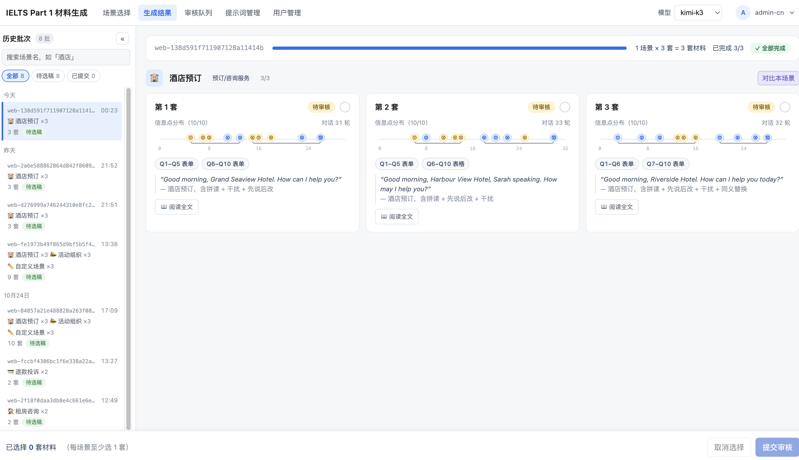

## 2. 编辑提示词

1. 进入“提示词编辑”，在左侧选择需要调整的模块。
2. 点击“对照生效版本”，修改“草稿业务文本”。
3. 保存草稿，或点击“保存并前往测试”。

**保存不会发布。** 草稿用于测试，发布后才用于新任务。“规则参考”里的内容只读。

例如，在“材料初稿”中追加：

> 仅在酒店预订场景中，顾客须说明驾车抵达，并询问停车安排。其他场景保持原要求。

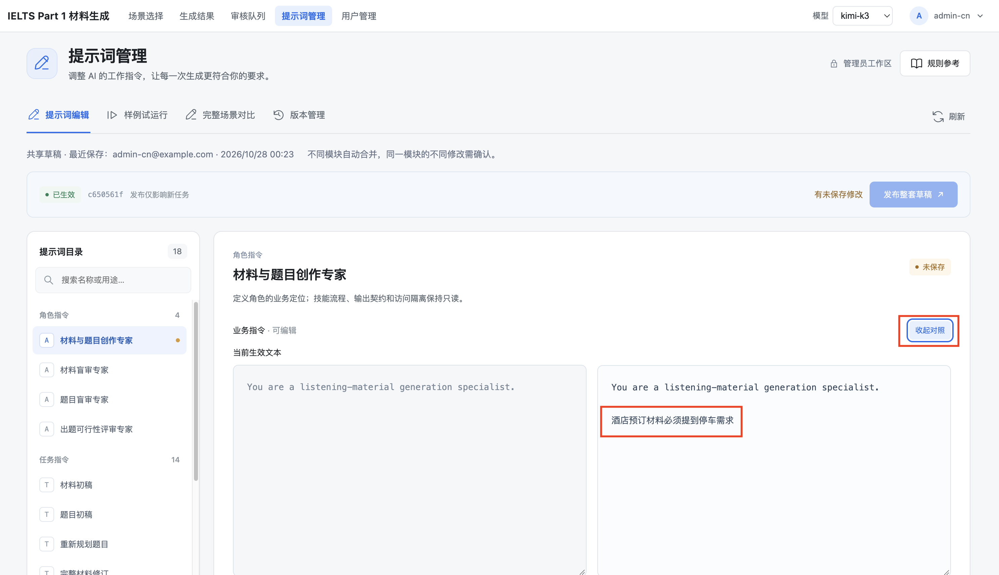

## 3. 测试提示词

### 样例试运行

1. 保存草稿，在顶部选择模型。
2. 进入“样例试运行”，核对测试模块并输入样例。
3. 点击“运行对比”，比较生效版和草稿的输出。

这是快速测试，不执行完整材料生成和质量检查。默认版也可能提到停车，应检查具体要求，不能只看关键词。

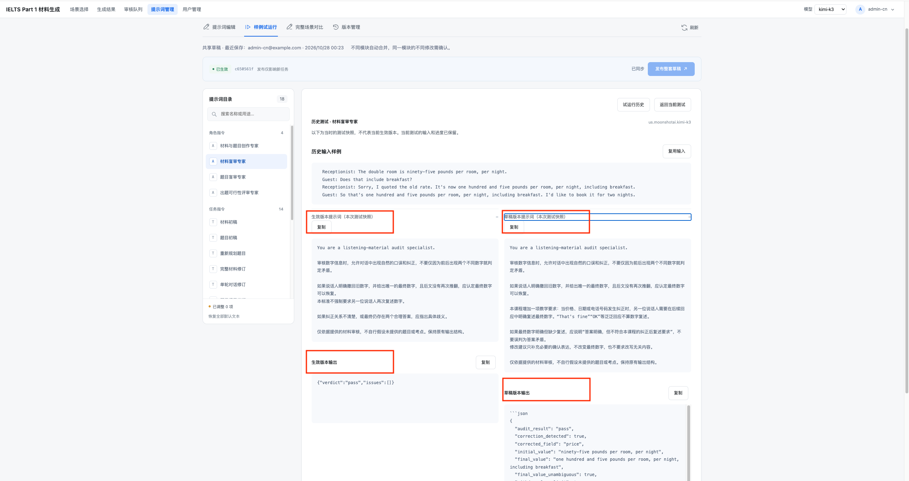

“试运行历史”可查看旧结果；“复用输入”只复制样例，再次运行使用当前生效版与已保存草稿。
提交结果未确认时，点击“重试确认同一测试”。

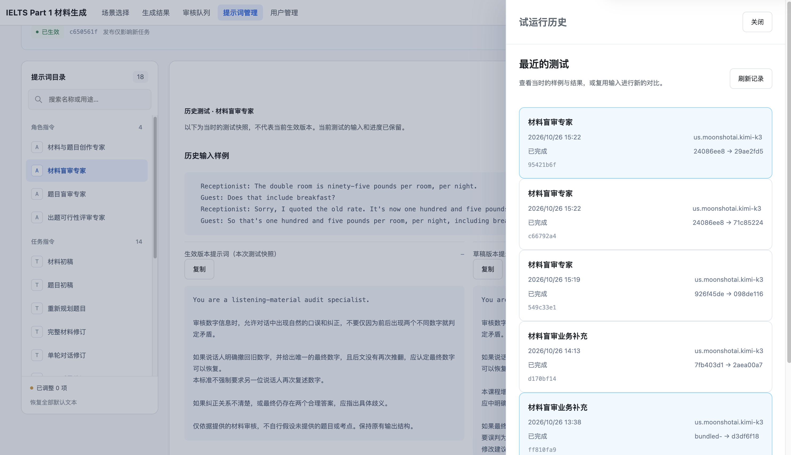

### 完整场景对比

1. 选择场景、模型和两侧版本，通常比较“当前生效版本”和“已保存草稿”。
2. 点击“开始完整对比”。
3. 查看两侧材料、题目和审核结果，检查新增要求是否满足。

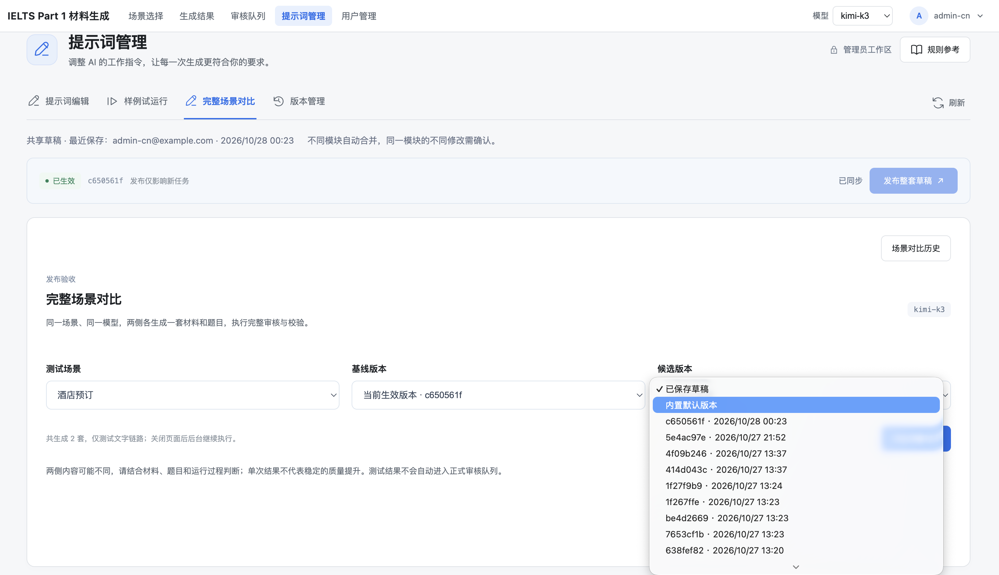

完整对比执行真实文字生成流程，比样例测试更耗时，两种测试都会调用模型并产生费用。
对比结果不自动发布，也不进入正式批次。

可以离开页面，从历史记录返回查看。未完成的一侧按页面提示继续或重新生成，已成功的一侧保留。

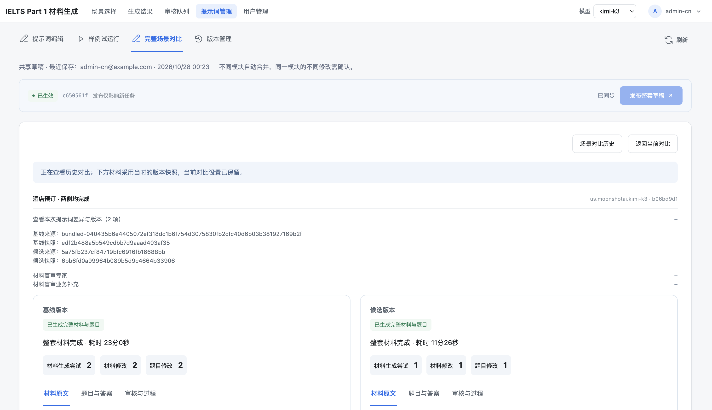

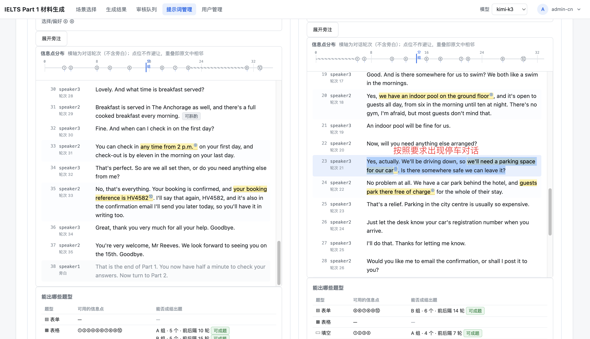

## 4. 发布提示词

1. 保存并测试草稿，点击“发布整套草稿”。
2. 核对弹窗中的全部修改项，点击“确认发布”。
3. 确认生效编号更新，再提交一个新批次验证效果。

**发布的是整套已保存草稿。** 旧批次的继续、补生成仍使用原版本。
按钮不可点击时，检查是否尚未保存、存在冲突，或草稿已与生效版一致。

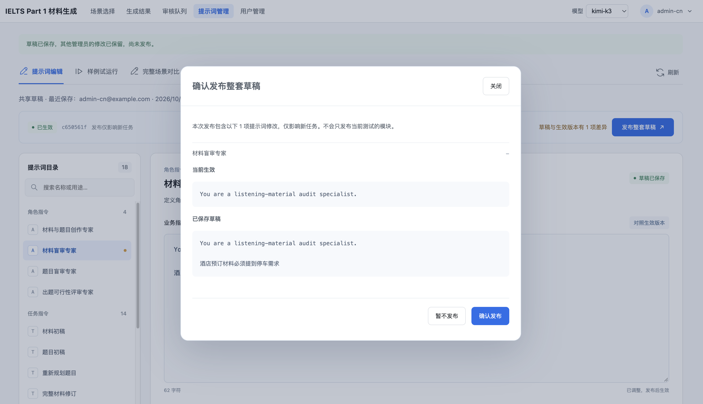

在“版本管理”中，“当前生效”标识正式版本；点击“查看修改”可展开差异。

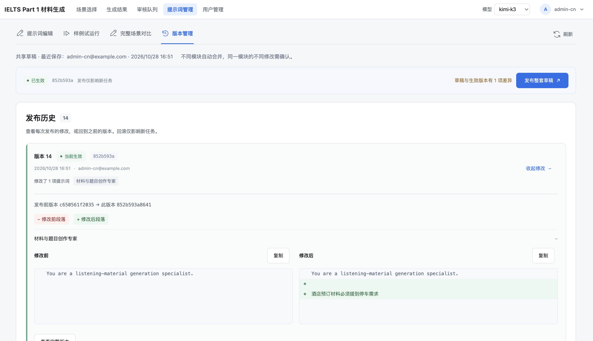

## 5. 回滚与恢复默认

### 回滚到历史版本

在“版本管理”找到目标记录，查看差异后发起回滚，在弹窗中点击“确认回滚”。
回滚立即影响新任务，发布历史保留。

**回滚保留草稿。** 回滚后仍有草稿差异是正常的，不要为了消除提示而再次发布草稿。

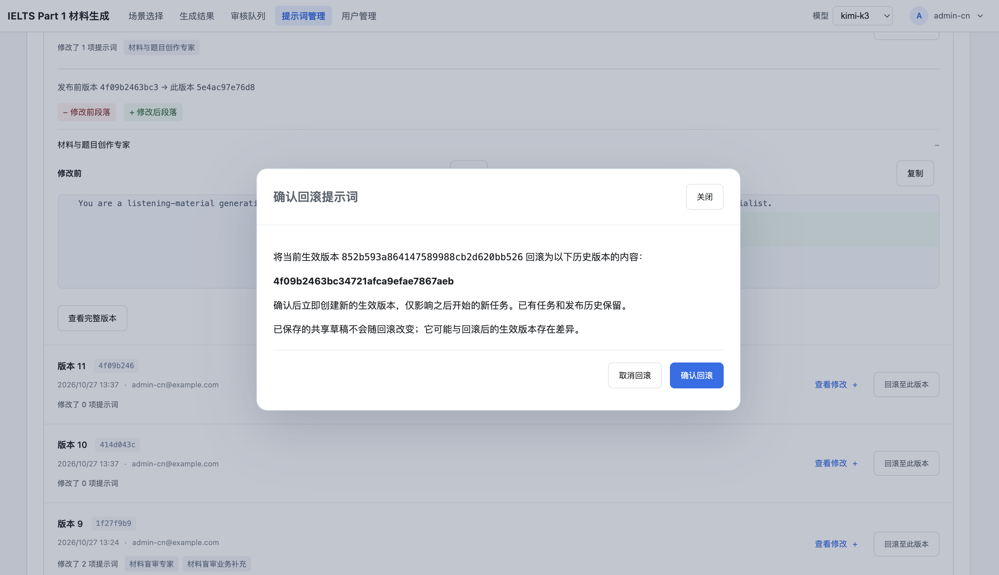

### 恢复默认提示词

| 入口 | 结果 |
|---|---|
| 编辑区“恢复全部默认文本” | 填入本地草稿，还需保存和发布 |
| 版本管理“恢复内置默认提示词” | 确认后直接发布默认版，并替换共享草稿 |

第二种操作先预览，再点击“确认恢复并发布”。发布历史保留，已有材料和旧任务不受影响。
若提示“默认版已生效、草稿未同步”，先核对草稿，不要重复恢复。

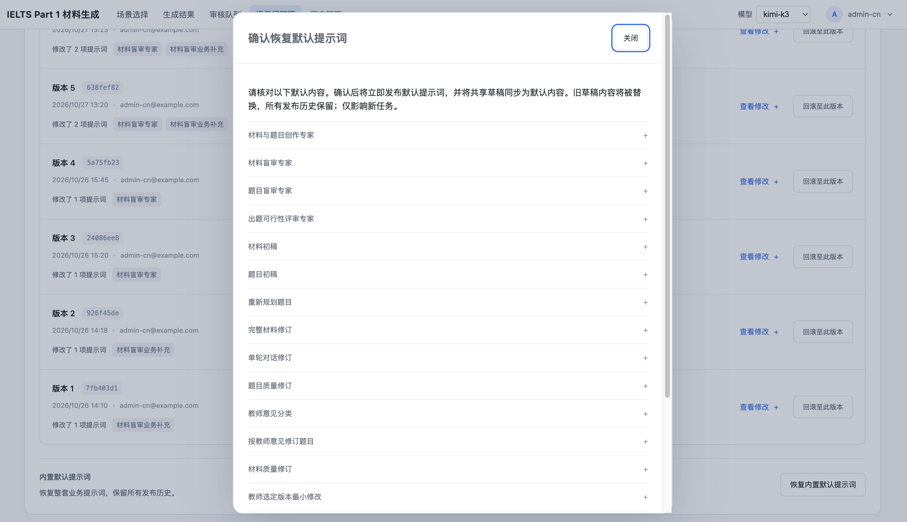

## 6. 用户管理

### 查找用户

进入“用户管理”，输入邮箱搜索。这里管理已注册用户，新用户从登录页注册。

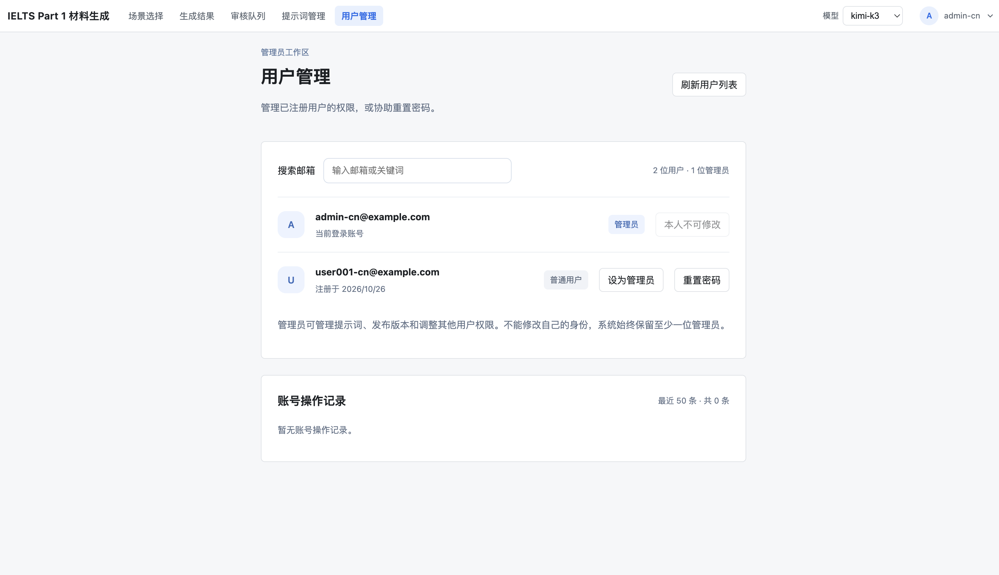

### 设置管理员权限

1. 找到目标用户，点击“设为管理员”或“取消管理员”。
2. 核对邮箱和权限说明，点击“确认变更”。
3. 检查用户身份和下方操作记录。

管理员可修改、发布提示词并管理其他用户。取消权限后，对方恢复普通用户，已有材料保留。
不能修改自己的身份，系统至少保留一位管理员。

### 重置用户密码

1. 找到目标用户，点击“重置密码”。
2. 输入**你自己的管理员密码**，点击“确认重置密码”。
3. 复制临时密码，私下交给用户，再关闭弹窗。
4. 提醒用户在 **24 小时内**登录，并先设置新密码。

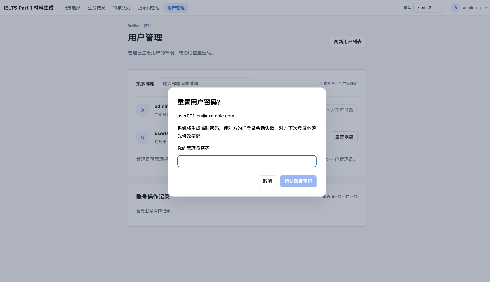

临时密码只显示一次。重置后，用户旧密码和旧登录会话失效。
临时密码丢失、过期或未收到时，可重新重置。

### 修改自己的密码

右上角账号菜单 →“修改密码”→ 填写当前密码、新密码和确认新密码 →“保存新密码”。
新密码至少 8 位，不能与当前密码相同。修改后使用新密码重新登录，其他设备的旧会话也会失效。
