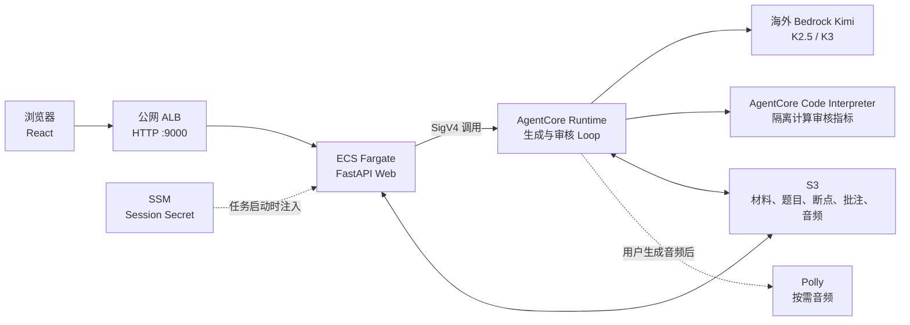
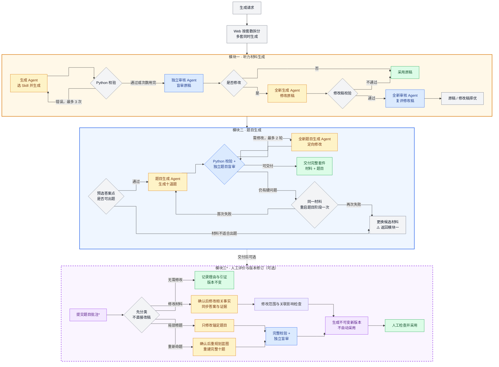

# IELTS Listening Part 1 材料生成系统

这是一个面向 IELTS 出题人员的材料生产与审核系统。用户选择场景和数量后，系统生成候选
听力对话、十个信息点和对应题目，分别执行程序校验与独立 AI 盲审，再将完整套件逐套返回浏览器。

系统的边界：

- **自动生成流程交付完整文字套件**：对话稿、十个信息点、自然题组中的十道题、答案与证据、校验结果和
  审核结果。
- **材料和题目分别审核**：材料审核看不到生成者的 `blueprint`；题目审核看不到答案键，再由 Python
  将独立重建结果交叉检查。
- **交付后可从题目或 Turn 批注发起修订**：题目支持局部修改、重新命题或修改材料；原文支持单个
  Turn 的局部修改。成功结果保存为新版本，不自动覆盖当前采用版本。
- **不在生成流程中合成音频**：用户主动生成音频时，系统才按需调用 Polly；提交审核不会自动
  触发音频合成。

> 📘 **出题人员请先阅读 [`USER_GUIDE.md`](USER_GUIDE.md)，了解材料生成、审阅、评价和版本采用的
> 完整操作流程。**
>
> 🛠️ **管理员请先阅读 [`ADMIN_GUIDE.md`](ADMIN_GUIDE.md)，了解提示词编辑、测试、发布、回滚和用户权限、密码管理的操作流程。**
>
> 本 README 主要面向开发、部署和运维人员。

> 🤖 **使用 Agent 部署：** 请将下面的提示词交给 Agent。完整要求见
> [`AGENT_DEPLOYMENT.md`](AGENT_DEPLOYMENT.md)。

```text
请负责部署这个项目。开始前必须完整阅读仓库根目录的
AGENT_DEPLOYMENT.md，并严格遵守其中的部署顺序、安全边界、失败处理和验证清单。

先确认这是首次部署还是更新部署，并核对目标 commit、AWS 区域和唯一 RELEASE_TAG。
不要修改业务代码，不要复用已有镜像标签，不要创建线上测试账号或测试数据，不要执行
teardown，也不要在没有明确要求时重复运行完整测试套件。

缺少必要信息时先集中列出；信息齐全后完成部署。任何步骤失败时立即停止，不要继续部署
下一层。完成后按文档规定的格式汇报实际部署层、Runtime、ECS task definition、镜像
digest、健康检查和遗留问题。
```

> 🇨🇳 **AWS Global 与中国区（宁夏）服务对比：** 应用入口、模型服务、认证、语音、存储及发布方式的差异见
> [架构及服务对比](docs/China_Region_架构设计.md)。部署、更新与回退见
> [中国区部署指南](docs/CHINA_DEPLOYMENT.md)，版本记录见 [发布台账](deploy/RELEASES.md)。

## 1. 项目目录

下面列出版本控制中的主要目录和入口。测试夹具、截图脚本等同类文件只展示其所在目录，避免用
文件清单淹没主线。

```text
.
├── README.md                         # 技术、部署和运维手册
├── AGENT_DEPLOYMENT.md               # 交给 Agent 执行部署的操作规范
├── USER_GUIDE.md                     # 出题人员使用说明
├── ADMIN_GUIDE.md                    # 管理员提示词与用户管理操作指南
├── pytest.ini                        # Python 测试发现配置
├── config/
│   └── scenarios.yaml                # 场景分类、角色和场景说明
├── material/
│   └── Part1_选材命制规范.md          # IELTS Part 1 选材与命制规范
├── skills/                           # 生成、审核与可行性检查 Skill；池划分就是盲审边界
│   ├── generate/                     # 生成 Agent 的池
│   │   ├── generate-listening-part1/
│   │   │   ├── SKILL.md              # 材料生成任务入口规范
│   │   │   ├── references/specification.md
│   │   │   ├── schemas/              # material、blueprint JSON Schema
│   │   │   └── scripts/validate_part1.py
│   │   └── generate-questions-part1/ # 题目生成、Schema 与 validator
│   ├── audit/                        # 审核 Agent 的池；不含 blueprint schema
│   │   ├── audit-listening-part1/
│   │   │   ├── SKILL.md              # 材料审核任务入口规范
│   │   │   ├── references/audit-rubric.md
│   │   │   ├── schemas/audit.schema.json
│   │   │   └── scripts/audit_metrics.py
│   │   └── audit-questions-part1/    # 不看答案键的题目审核
│   ├── feasibility/                  # 出题前检查十个预选答案点是否可听出、唯一且可填空
│   └── shared/                       # 两侧都不激活的离线工具
│       ├── cross_check.py            # 生成标注与盲审结果交叉检查
│       └── tests/                    # Skill 契约回归测试
├── backend/                          # AgentCore Runtime
│   ├── Dockerfile                    # Runtime ARM64 镜像
│   ├── pyproject.toml                # Python 依赖与 pytest 配置
│   ├── app.py                        # Runtime action 入口
│   ├── request.py                    # 生成请求解析
│   ├── agents.py                     # 两类 Strands Agent、Skill 池和工具权限
│   ├── sandboxed_metrics.py          # 在 AgentCore Code Interpreter 中计算审核指标
│   ├── model/provider.py             # Kimi Chat Completions 与历史 Mantle Responses 适配
│   ├── steps/
│   │   └── agent_steps.py            # generate、audit、revise 的输入输出边界
│   ├── deterministic/                # 校验、指标、锚点与交叉检查包装
│   ├── orchestration/
│   │   ├── loop.py                   # 单套材料 Agent Loop
│   │   ├── question_loop.py          # 单套题目生成、审核与最多两轮修改
│   │   ├── manual_question_revision.py # 题面级批注修订
│   │   ├── manual_question_replan.py # 保持材料不变的完整重命题
│   │   ├── accepted_material_revision.py # 基于采用版本修改相关事实、答案与证据
│   │   ├── manual_material_local_revision.py # 单个 Turn 的材料原文局部修改
│   │   ├── delivery.py               # 完整套件、换材料、断点与精确数量交付
│   │   ├── batch.py                  # 旧的仅材料 action 与测试入口
│   │   ├── candidate_store.py        # 候选材料注册
│   │   └── publish.py                # 选稿、试听和异步音频任务
│   ├── scripts/                      # 部署、冒烟和 CI 门禁
│   ├── tests/                        # 后端测试
│   └── docs/                         # 时延、模型接入和交接记录
├── prompt_config/                    # 共享草稿、发布版本、任务绑定与默认提示词
├── qti_export/                       # 题目包 → QTI 2.2.4 内容包（导出给下游题库）
│   ├── README.md                     # 字段映射、容错规则、准入门禁
│   ├── questions_input.py            # 输入读取与门禁 G1–G6
│   ├── accept_sets.py                # 答案容错集 / 拒绝集
│   ├── emitter.py                    # QTI item + manifest + zip 序列化
│   ├── service.py                    # 两种存储形状收敛 + export_document 入口
│   ├── validate.py / fetch_schemas.py # 官方 XSD 校验与镜像（测试/CLI 用）
│   └── tests/                        # 三份真实交付集夹具（form / table / note）
├── audio_storage/                    # 按需音频与材料状态存储
│   ├── synthesize.py                 # Polly 逐轮合成
│   ├── state_store.py                # pending/approved 等状态迁移
│   ├── manifest.py                   # 音频完整性 manifest
│   ├── config/pronunciation.yaml     # 发音覆盖规则
│   └── tests/
├── web/                              # 面向浏览器的 FastAPI 服务
│   ├── Dockerfile                    # Web + 前端静态资源镜像
│   ├── app.py                        # API、静态文件与认证入口
│   ├── fanout.py                     # 每套一次 Runtime invocation，合并为 SSE
│   ├── runtime_client.py             # SigV4 AgentCore 客户端
│   ├── auth.py                       # 登录、session、管理员与密码管理
│   ├── batch_recovery.py             # 断点恢复、模型故障重试与请求去重
│   ├── batch_store.py                # 批次持久化
│   ├── comment_store.py              # `_comments/` 单人批注存储与校验
│   ├── question_versions.py           # 修订请求与不可变版本的持久化/采用
│   └── tests/                        # 含 test_qti_export_route.py（/api/material-qti）
├── frontend/                         # React + TypeScript + Vite 审阅界面
│   ├── src/
│   │   ├── api/                      # Web API 与 SSE 客户端
│   │   ├── auth/                     # 登录状态
│   │   ├── contracts/                # 从 Schema 生成的类型
│   │   ├── domain/                   # 展示与比较逻辑
│   │   ├── features/                 # 场景、进度、阅读、比较、音频
│   │   └── stores/                   # Zustand 状态
│   ├── public/config.json            # 运行时前端配置
│   ├── scripts/                      # codegen 与视觉检查脚本
│   ├── package.json                  # 依赖和 npm 命令
│   ├── vite.config.ts
│   ├── vitest.config.ts
│   └── tsconfig.json
├── deploy/
│   ├── china_infra.py                # prepare / edge / web / status
│   ├── push_image.py                 # ARM64 镜像推送与 digest 固定
│   ├── runtime_release.py           # Runtime 发布和旧镜像回退
│   ├── model_credentials.py         # 海外模型专用凭证与中国区 Secret
│   ├── model_access.py              # Kimi K3 调用权限
│   ├── runtime_role.py              # 中国区 Runtime 执行角色
│   └── RELEASES.md                  # 发布记录规范与历史入口
└── docs/ui/                          # UI 原型
```

## 2. 系统架构



### 2.1 每个组件负责什么

| 组件 | 职责 |
|---|---|
| 浏览器 | 选择场景、显示逐套生成进度、审阅原文和题目、提交题目或 Turn 批注、管理版本、生成音频或提交审核 |
| ALB | 提供带端口的公网 HTTP 地址，将请求转发到内部 Web 服务 |
| Web / ECS | 登录、批次历史、后台执行、修订版本、调用 Runtime，并把运行进度投影为 SSE |
| AgentCore Runtime | 创建 Strands Agent，执行材料与题目的生成、校验、盲审、修改和按需音频 action；`PUBLIC` 网络模式用于访问 AWS 公网服务 |
| AgentCore Code Interpreter | 在空白远程环境中运行审核指标脚本；只接收脚本和当前 `material` |
| 模型服务 | 海外 Bedrock Kimi K2.5 / K3；旧 GPT/Mantle 适配保留，生产凭证通过中国区 Secrets Manager 引用 |
| S3 | 保存候选材料、题目包、批次、断点、用户数据、个人批注、审核状态和按需生成的音频 |
| SSM | 保存 Web session 签名密钥，避免容器重启后用户集体掉线 |
| Polly | 仅在用户主动生成音频时合成英式语音 |

登录后可在顶部导航栏选择部署允许的模型，当前中国区展示 Kimi K2.5 和 Kimi K3，默认选中 K2.5；
GPT 适配代码作为历史兼容保留，不在中国区交付模型列表中开放。模型目录与应用部署区域独立。当前选择会用于
之后提交的材料生成、题目修改、重新命题和材料修改，刷新页面后仍会保留。已经运行的任务继续使用
提交时的模型，不会中途切换；`IELTS_MODEL_ID` 仍是目录读取失败或未指定模型时的部署默认值。

### 2.2 一次生成请求如何流转

1. 浏览器向 Web 服务提交场景和数量。
2. `web/fanout.py` 为每套材料向同一个已部署的 AgentCore Runtime 发起一次独立 invocation，
   每次使用不同的 `runtimeSessionId`，并按 `WEB_FANOUT_CONCURRENCY` 控制并发。
3. 每次 invocation 为一套结果执行第 3 节的 Agent Loop，依次完成材料、可行性预检和十道题。
4. Web 将多条 Runtime 流合并为一条 SSE；浏览器可逐套看到结果，材料卡同时预览两组题型。
5. Web 同时把批次索引和结果保存到 S3，供刷新页面和历史查询使用。

`generate_sets` 使用 SSE，因此适用 AgentCore 的 60 分钟流式上限，而不是 15 分钟同步上限。
每套拥有独立的 Runtime invocation 和 55 分钟工作窗口；Web 使用独立线程池承载阻塞式 boto3
长连接，避免占满 FastAPI/anyio 默认线程池。

浏览器只是进度观察者，不拥有生成任务。关闭 SSE、刷新或离开页面不会关闭 Runtime body，也不会
取消批次或修订；Web 的后台 execution 持续消费结果并把终态写入 S3。重新打开页面后，前端从持久化
状态恢复。批次某个 slot 失败时，“补生成这一套”启动独立 refill execution，但成功结果回填原批次
原位置，不创建第二个用户可见批次。

### 2.3 音频为什么不在生成流程里

中国区音频采用标准英式音色，并通过需要登录的 Web 音频代理播放，支持分段读取；浏览器不直接访问 S3 预签名地址。

生成成功后不会调用 Polly。当前用户界面只有主动点击“生成音频”才会触发音频合成：

- **生成音频**：`preview_audio` 为某个候选材料启动异步合成，但不改变提交审核状态；
- **提交审核**：只记录用户选择的材料，不调用 Polly，也不会删除同场景的其他候选材料。

Runtime 立即返回 job id，浏览器通过 `audio_status` 轮询。合成完成后才能通过
`presign_audio` 获得本站鉴权音频地址。底层仍保留 `select` action 作为兼容入口，但当前“提交审核”
流程不会调用它。这样生成批次和提交审核都不会因为 30 到 45 次 Polly 请求而变慢。

### 2.4 网络与凭证边界

- 浏览器不持有 AWS 凭证，只调用同源 `/api/*`，登录态存放在 HttpOnly cookie。
- Web 使用 ECS task role 的临时凭证签名 `InvokeAgentRuntime`，没有长期 access key。
- Runtime 不直接面向浏览器。当前部署使用 AgentCore `PUBLIC` 网络模式，但调用托管 Runtime
  endpoint 仍需 SigV4 签名和 `bedrock-agentcore:InvokeAgentRuntime` 权限。
- S3 对象全部私有；浏览器通过 Web 的 `/api/material-audio` 鉴权代理播放音频。
- 公网 ALB 使用非标准 HTTP 端口，容器内部仍为 80；容器安全组仅允许 ALB 访问。
- Web 每 15 秒发 SSE 心跳，ALB idle timeout 默认为 120 秒；部署后仍需验证客户网络长连接。
- 当前入口使用 HTTP，没有 HTTPS 传输加密；自有域名与 HTTPS 接入需另行配置。

### 2.5 鉴权与用户池

系统**没有使用 Cognito**。`web/auth.py` 将用户保存在
`s3://ielts-part1-materials-{account}/web/users.json`，使用 PBKDF2 密码摘要和由 SSM 密钥签名的
7 天 HttpOnly cookie；`ALLOWED_EMAIL_DOMAINS` 控制新用户注册。本地开发可回退到本地 JSON。
注册邮箱须属于部署时通过 `china_infra.py web --email-domains` 配置的客户域名；
`example.com` 仅为工具默认示例，交付时应替换。部署工具拒绝 `*`。
第一个注册成功的账户自动成为管理员，首次开放入口时应由指定负责人完成注册，再由管理员管理其他账号。
用户可在账户菜单修改密码；忘记密码时联系管理员重置。当前不提供邮箱验证、自助邮件找回、MFA 或企业 SSO。

### 2.6 题目如何交付给下游（QTI 2.2.4 导出）

题目预览页上方有「导出 QTI 2.2（Vn）」按钮，对应 `GET /api/material-qti/{material_id}`。Web 层从
`_questions/`（原始交付）或 `_question_versions/`（批注修订版本）读出题目文档，在进程内用
`qti_export/` 转成 **IMS QTI 2.2.4** 内容包并直接下载，不经过 Runtime、不写回 S3：

```text
ielts-<material_id>-v<n>.zip
├── imsmanifest.xml                        Content Package manifest
├── items/part1-<material_id>-v<n>.xml     assessmentItem：十题一个 item，十个 textEntryInteraction
├── reject_candidates.json                 每题接受集 / 拒绝集，供下游判分回归
└── review.txt                             需人工确认的判分口径（存在时才有）
```

三条设计决定：

- **导出的是页面正在显示的版本**，版本号进 `assessmentItem/@identifier`（`ielts-<material_id>-v<n>`），
  同一材料的两个版本在下游题库里不会互相覆盖。`?version_id=` 缺省为当前采用版本。
- **按老师选定版本导出**：检查题目结构、十题完整性和可序列化性；失败返回 422，不丢题后导出残缺包。
  页面路径不重新裁决历史模型审核意见，也不重新生成答案。
- **音频由下游另行挂载**：QTI 包不包含音频，manifest 不声明音频资源。

页面导出保留所选版本的标准答案及显式 `alternatives`，不推导额外可接受答案。
离线 CLI 的审核门禁与答案扩展规则独立说明于 [QTI 模块文档](qti_export/README.md)，不能套用到页面导出。
`?format=item` 只取 item XML，`?format=summary` 取 JSON 概览。离线转换：
`python3 -m qti_export <material_id>.json -o build/ --validate`。

## 3. 生成流程（Agent Loop）



这张图按三个模块表达系统结构：模块一生成并审核听力材料，模块二生成并审核对应题目；二者是每次
生成都要经过的主流程。带星号、虚线边框的模块三是**交付后的可选优化步骤**，只有用户提交题目或 Turn 批注
时才进入，不属于一次生成请求的必经路径。区域内部，黄色节点是负责写作或改稿的生成 Agent，蓝色
节点是独立审核，灰色节点是 Python 控制的校验、预检和重试，绿色节点是采用或交付结果。图只表达
整体方向；各层的重试边界和交付门槛在下文说明。

整个流程可以按下面的顺序理解：

1. **并行生成**：Web 按用户要求的套数拆分任务，每套任务在独立的 Session 中运行，彼此互不影响。
2. **生成初稿**：生成 Agent 产出对话稿和十个信息点的蓝图。
3. **程序校验**：Python 检查格式与标注；失败时带着报告重试，最多三次。
4. **独立盲审**：审核 Agent 看不到蓝图，独立评价并重建信息点；Python 再与蓝图交叉检查。
5. **修改复评**：有缺陷时由新 Agent 修改，再由新审核 Agent 从零复评；Python 在原稿和修改稿
   之间择优。
6. **可行性预检**：在写题前逐项检查十个预选答案是否能从录音中听出、是否只有一个正确答案，
   以及是否能自然填入 Form、Note 或 Table；任一点不成立就更换材料并重新开始。
7. **题目生成与盲审**：题目 Agent 生成十道题；Python 校验后，题目审核 Agent 在不看答案键的
   情况下独立重建答案，再由 Python 交叉检查。
8. **定向修题与恢复**：有问题时只修改题面、答案键和证据，不动录音原文，最多两轮。仍不可交付
   时先重启一次题目阶段，再失败则更换材料。
9. **完整交付**：每套必须同时包含材料和十道题才算完成；要求 N 套时，N 套全部完成才算成功。
10. **人工评价与版本修订***：交付后可以针对题目提交批注。系统先判断无需修改、局部修题、重新命题
    或修改材料；按相应路径检查质量。材料事实修改只检查修改范围和关联影响，不重新裁决无关的既有问题，
    生成一个不会自动采用的新版本。此步骤是
    后续优化能力，不是生成完整套件的必经阶段。

`*` 表示可选的交付后流程。

因此，这套系统不是让一个 AI 从头到尾自行决定下一步，而是
“**Agent 执行需要理解语言的工作，Python 控制流程并验收结果**”：

- Agent 负责激活 Skill、读取规范、生成材料与题目、盲审和修改；
- Python 负责拆分任务、保存断点、控制两层重试、隔离盲审输入、运行外部校验、决定换材料并选择
  最终版本。

Agent 不能凭自己运行过 validator 就宣布通过。Python 会在 Agent 返回后重新校验真实产物。
下面各小节沿着这条流程，说明每一步如何落到代码中。

### 3.1 请求进入一个完整套件的 Loop

一次请求的实际调用链如下：

```text
浏览器 POST /api/invocations（action=generate_sets）
  → web/app.py
  → web/fanout.py：按数量拆成一套一个 ChildPlan
  → web/runtime_client.py：每套使用新的 runtimeSessionId 调用 AgentCore
  → backend/app.py::invoke(payload)
  → backend/request.py::parse_delivery_request()
  → backend/orchestration/delivery.py::stream_request()
  → backend/orchestration/loop.py::run_one()              # 材料阶段
  → backend/orchestration/question_loop.py::run_questions() # 题目阶段
```

Runtime 的 Python 入口是 `backend/app.py` 中的 `@app.entrypoint invoke()`。它读取 payload 的
`action`：当前前端使用 `generate_sets` 生成完整材料与题目；旧的 `generate` 仍保留为仅材料路径和
兼容入口。`list_scenarios`、`select`、`preview_audio` 等进入各自 action。

Python 最终传给生成 Agent 的不是整套命制规范，而是明确的任务和场景，例如：

```text
Generate one listening material for the scenario below.

id: booking-hotel
category: booking
title: 酒店预订
客户联系酒店前台咨询并预订房间……
```

### 3.2 创建当前流程所需的 Agent

进入具体 AI 步骤时，Python 根据当前阶段创建生成 Agent 或审核 Agent。Agent 不是运行时生成的
一段新代码；`backend/agents.py` 保存固定定义，Python 每次调用时据此创建一个新的 Strands
`Agent` 对象：

```python
Agent(
    model=provider.build_model(...),
    system_prompt=...,
    plugins=[AgentSkills(skills=Skill.from_directory(...))],
    tools=...,
    sandbox=ReadOnlySkillSandbox(...),
)
```

创建新实例是为了隔离会话：不同材料、生成重试、第一次盲审和修改后复评都不共享对话历史或
Skill 激活状态。

系统沿用“生成侧 / 审核侧分池”的边界，并按任务创建不同 Agent：

| Agent | Skill 池 | 工具 | 用途 |
|---|---|---|---|
| 材料生成 Agent | `skills/generate/` | `skills`、`file_read`、`shell` | 材料初稿生成与修改 |
| 材料审核 Agent | `skills/audit/` | `skills`、`file_read`；**无 shell** | 不看 blueprint 的材料盲审与复评 |
| 题目生成 Agent | `skills/generate/` | `skills`、`file_read`、`shell` | 题目初稿与最多两轮定向修改 |
| 题目审核 Agent | `skills/audit/` | `skills`、`file_read`；**无 shell** | 不看答案键的题目盲审与复评 |
| 可行性 Agent | `skills/feasibility/` | 只读 | 正式出题前检查十个信息点是否都适合出题 |

修改没有单独的 Skill。修改步骤创建一个全新的生成 Agent，复用生成 Skill，因为修改稿仍须满足
同一份 specification、Schema 和 validator。

### 3.3 Agent 激活并执行 Skill

`backend/agents.py` 使用 Strands SDK 的原生目录加载：

```python
skills = Skill.from_directory("skills/generate")
plugin = AgentSkills(skills=skills)
```

system prompt 要求模型执行下面的过程：

```text
Agent 先看到池内 Skill 的 name + description
  → 根据任务调用 skills("generate-listening-part1")
  → 获得 SKILL.md 和资源清单
  → 用 file_read 打开 reference 与 Schema
  → 生成 Agent 用 shell 运行 Skill 指定的 validator
  → 返回 Skill 规定的 JSON
```

这些动作由模型通过工具调用完成，不是 Python 逐项强制的状态机。

材料主线的两个 Skill 是：

| | 生成 Skill | 审核 Skill |
|---|---|---|
| 目录 | `skills/generate/generate-listening-part1/` | `skills/audit/audit-listening-part1/` |
| 入口 | `SKILL.md` | `SKILL.md` |
| 规范 | `references/specification.md` | `references/audit-rubric.md` |
| Schema | `material.schema.json`、`blueprint.schema.json`（写侧，只允许 v3）、`blueprint.read.schema.json`（读侧兼容历史版本） | `audit.schema.json` |
| 脚本 | `validate_part1.py` | `audit_metrics.py` |

生成结果的统一外壳是：

```json
{
  "material": {},
  "blueprint": {}
}
```

`material` 是对话稿；`blueprint` 是生成者声明的十个信息点，包括答案、证据句、对话位置和适用
题型。`agent_steps.py` 负责解析这个外壳，并补上模型无法可靠知道的真实模型 id 和 UTC 时间。

题目阶段另有 `generate-questions-part1` 与 `audit-questions-part1`。生成侧返回
`question_face + answer_key + evidence`；审核侧只接收材料、考生可见题面和客观指标，不接收
`answer_key`，独立重建十个答案后由 Python 交叉检查。

### 3.4 生成与双层确定性校验

生成 Agent 被要求在一次调用内部执行完整 Skill 工作流：

1. 读取 specification 和两份 Schema；
2. 生成 `material` 与 `blueprint`；
3. 将临时 JSON 写进本次调用独占的 `/tmp/ielts-gen-*` 目录；
4. 用 `shell` 运行 `validate_part1.py`；
5. 根据报告修改并重新检查；
6. 把两个完整产物放进回复，而不是只留在临时文件。

Agent 调用结束后，`GenerationWorkspace` 无论成功失败都会删除整个临时目录。随后 Python 仍然
执行独立校验：

```text
repair_anchors()
  → validate_part1.py
  → 通过：进入盲审
  → errors：累积反馈给新的生成 Agent，最多三次
```

validator 不调用模型，只检查可明确计算的规则：

- **数据格式**：必填字段、Schema、禁止出现的题目/答案/分析字段；
- **结构数量**：说话人、旁白、十个信息点、字数和轮数；对话推荐 28–35 轮，硬上限 36 轮；
- **标注一致性**：答案是否在证据句中、`turn_index` 是否指向该句、信息点顺序是否正确。

`warnings` 不触发重生成，只作为修改建议。三次仍有错误时保留最后一稿、继续审核并附上
`validation_findings`；校验是报告，不是扣住材料的闸门。429、空响应、错误 JSON 外壳等调用故障
使用独立的基础设施重试预算，不占三次内容生成机会。

### 3.5 盲审与指标沙箱

盲审前，Python 通过 AgentCore Code Interpreter 计算字数、轮数和前后半段分布。远程环境从空白
开始，只上传：

```text
audit_metrics.py
material.json
```

不会上传 `blueprint`。同一个 Code Interpreter session 可在修改后复评时复用，但只替换
`material.json`，完成后由 `loop.py` 关闭。

审核 Agent 接收的业务输入被 `BlindAuditInput` 固定为两个字段：

```text
material + metrics
```

它激活审核 Skill、读取 rubric，并在看不到本材料 `blueprint` 的情况下独立重建信息点。Python
随后执行纯代码交叉检查：

| 生成者的 `blueprint` | 盲审独立找到 | 结果 |
|---|---|---|
| 入住日期：12 July | 入住日期：12 July | 匹配 |
| 房型：double room | 房型：double room | 匹配 |
| 价格：£85 | 未找到 | 需要检查或修改 |

隔离依靠多道边界：生成/审核 Skill 分池、审核 Agent 无 shell、请求不包含 blueprint、生成临时
目录在审核前删除、审核前执行 `assert_no_plan_on_disk()`、远程指标环境只上传两个白名单文件。

### 3.6 修改、独立复评与择优

如果原稿审核和交叉检查都干净，Python 直接交付原稿。否则在时间预算允许时：

1. `loop.py` 将审核缺陷和交叉检查结果整理成 must-fix / advisory；
2. 创建全新的生成 Agent，使用同一生成 Skill 输出完整修改版 `material + blueprint`；
3. Python 修复/核验锚点并再次运行 validator；
4. 修改稿不通过则回退到已经审核过的原稿；
5. 修改稿通过后，创建全新的审核 Agent，从零盲审修改稿；
6. Python 对原稿和修改稿执行 `pick_better()`，平分时选择修改稿。

第一次盲审和复评是同一种 Agent 配置，但不是同一个实例或会话。复评 Agent 看不到第一次审核结论
和修改指令，避免只针对已知问题寻找证据。

### 3.7 题目生成、盲审与定向修改

材料择优后，`delivery.py` 先运行可行性预检。这个 Agent 同时读取定稿材料和蓝图，但不生成题目，
也不重新评价材料整体质量；它只确认十个预选答案点都能被听出、唯一作答并自然填入
Form / Note / Table，同时检查蓝图的题型和分组符合材料的信息关系。通过后，题目生成 Agent 才将
这些已确认的答案点写成正式题面，`question_loop.py` 执行：

1. 题目生成 Agent 输出十道题、答案键和证据；固定分为两组，切分只能是 `4+6`、`5+5` 或 `6+4`，
   两组分别使用 Form、Note 或 Table，允许同题型；
2. Python validator 检查 Schema、题型结构、rubric、答案预算、证据和题面泄露；
3. 题目审核 Agent 只看考生可见题面与材料，独立重建答案；
4. Python 将重建答案与答案键交叉检查，识别分歧、竞争答案、泄露和证据锚点问题；
5. 若仍有问题，题目生成 Agent 根据明确 finding 定向修改，最多两轮，每轮重新走完整检查。

`CRITICAL`、`MAJOR`、答案泄露、同等成立的竞争答案、答案分歧和 validator error 都是硬阻断。
只有 `MINOR` 或允许保留的提示时可以作为 `WARNING` 交付。题目修改不得改录音原文；如果 Agent
返回了改写后的 script，整轮修改会被拒绝。

答案键可记录常见等价写法，包括日期顺序与缩写、时间格式、数字词形、金额、连字符和专有名词大小写；
数字词形仅在题目字数限制允许时加入。

### 3.8 精确数量、重启与换材料

`delivery.py` 把用户要求的每一套表示为一个 slot。slot 是交付名额，不是材料 id：

- 材料通过审核和可行性预检后先写入 `material_done` 断点，再开始出题；
- 题目阶段第一次崩溃或不可交付，保留该材料并完整重启题目阶段一次；
- 同一材料第二次仍不可交付，才消耗一次 `candidate_swap`，为这个 slot 更换候选材料；
- 所有阶段状态写入 S3；Runtime 中断时可以从最后完成的阶段继续，而不是重做已通过内容；
- 请求 N 套时，只有 N 个 slot 都达到 `complete` 才返回 `succeeded`。

### 3.9 人工批注、路由与不可变版本

交付后的人工修订从题目锚点批注开始。当前用户界面支持针对 Q1-Q10 提交评价。

`classify_question_revision` 先评价意见，不修改产物，并为每条批注给出四种结果之一：

| 结果 | 行为 |
|---|---|
| `no_change` | 记录理由和材料/题目引证，不创建版本 |
| `question_only` | 只允许修改批注锚定题目的题面、答案键或证据；材料和蓝图不变 |
| `replan_questions` | 用户确认后重建蓝图和完整十题；可用 `layout_only` 保留原信息点，仅调整 Form/Note/Table 和题组边界 |
| `revise_material` | 用户确认后，以采用版本为基础修改相关原文事实，同步关联蓝图、答案和证据；无关题面与原文不变，新音频需重新生成 |

原文页支持对单个非旁白 Turn 提交局部修改。`revise_material_local` 只采用锚定 Turn 的文字变化；
题目、答案、题组和其他 Turn 保持不变。越界意见只返回原因，不创建版本。原文发生变化后，新版本音频
标记为待重新合成。

所有成功修订都写成新的不可变版本，记录 `based_on_version_id`、来源批注和质量结果。新版本生成后不会
自动采用；用户可以先比较、试听，再显式采用。采用版本时材料、蓝图、题包、答案、证据和音频归属作为
一个快照切换，不能把不同版本的产物混在一起。

修订由 Web 后台 execution 持有，SSE 只负责观察；刷新页面不会中断。题面修改、重新命题和材料修改
每次执行都使用新的 `runtimeSessionId`，避免两个长任务共享 AgentCore microVM，也避免 Runtime 部署后
旧 session 继续运行旧镜像。相同 durable request 的重复点击由 execution id 去重，不会产生两个版本。

### 3.10 并发与时间预算

生产环境由 `web/fanout.py` 为每套材料发起一个独立 Runtime invocation，每个请求使用新的
`runtimeSessionId`。`WEB_FANOUT_CONCURRENCY=20` 表示同时最多运行 20 套，不是每批最多 20 套：
第一个任务完成后，队列中的下一套立即开始。这个数是可调的流量保护值，不是 AgentCore 硬限制；
出现 429 时应下调。

单次 Runtime invocation 只处理一个交付位置，内部生成流程串行执行；实际并发来自 Web 同时发起
多个独立 invocation。`generate_sets` 是 SSE 流式调用，适用 AgentCore 60 分钟上限：Runtime
使用 3600 秒硬上限、预留 300 秒收尾，工作窗口为 3300 秒；Web 的单套墙钟同为 3300 秒，
Runtime read timeout 为 3450 秒。

开始材料或题目阶段前，Python 会确认剩余时间足以覆盖该阶段的保守耗时。若不足则保存断点并诚实
返回 `incomplete`，不会把少于请求数量的结果标为成功。

### 3.11 核心代码索引

| 路径 | 作用 |
|---|---|
| `web/fanout.py` | 将批次拆成每套一次 Runtime 调用，限制并发并合并 SSE |
| `web/runtime_client.py` | SigV4 调用 AgentCore，为每次调用设置独立 `runtimeSessionId` |
| `web/question_versions.py` | 修订决策、执行记录、不可变版本和采用状态 |
| `backend/app.py` | AgentCore Python 入口和 action 路由 |
| `backend/request.py` | 把场景 id、数量和自定义场景解析为 slot |
| `backend/orchestration/loop.py` | 单套材料的重试、校验、盲审、修改、复评和择优 |
| `backend/orchestration/question_loop.py` | 十道题的生成、校验、盲审、交叉检查和最多两轮修改 |
| `backend/orchestration/manual_question_revision.py` | 批注范围内的局部题目修改 |
| `backend/orchestration/manual_question_replan.py` | 材料不变的蓝图重规划和完整重命题 |
| `backend/orchestration/accepted_material_revision.py` | 采用版本的范围内事实修改与关联影响检查 |
| `backend/orchestration/manual_material_local_revision.py` | 单个 Turn 的材料原文局部修改与质量门禁 |
| `backend/orchestration/delivery.py` | slot 状态、可行性预检、题目重启、换材料、断点和精确数量交付 |
| `backend/orchestration/slot_store.py` | `_slots/` 与 `_questions/` 的 S3 持久化 |
| `backend/orchestration/batch.py` | 旧的仅材料 `generate` action 与测试入口 |
| `backend/agents.py` | Strands Agent、Skill 池、工具和只读 Skill sandbox |
| `backend/steps/agent_steps.py` | 三类模型调用的消息与输入输出边界 |
| `backend/deterministic/anchors.py` | 可确定修复的 blueprint 锚点同步 |
| `backend/deterministic/validate.py` | Python 调用生成 Skill validator 的包装 |
| `backend/deterministic/crosscheck.py` | blueprint 与盲审信息图交叉检查 |
| `backend/sandboxed_metrics.py` | Code Interpreter session 与白名单文件上传 |

### 3.12 如何扩展到其他 IELTS 能力

**增加采用同类工作流的 Skill**：在对应池中增加一个包含 `SKILL.md` 的目录，并提供它声明的
references、Schema 和 scripts。`Skill.from_directory()` 会自动发现 Skill，无需在 `agents.py`
写新的目录名。

```text
skills/
├── generate/
│   ├── generate-listening-part1/
│   └── generate-reading-passage1/       # 示例，当前不存在
└── audit/
    ├── audit-listening-part1/
    └── audit-reading-passage1/          # 示例，当前不存在
```

Skill 自动发现不等于新学科已经端到端可用。扩展 Reading/Writing 仍需增加任务路由、产物契约、
确定性脚本、Loop 策略和前端交互。

## 4. 部署前准备

当前完整发布工具支持中国区宁夏 `cn-northwest-1`。准备中国区账号/profile、海外模型账号/profile、
可访问的 Docker ARM64 构建环境和客户注册邮箱域名。账号需具备默认 VPC，以及至少两个可用区中有公网 IGW 路由的子网。
应用资源与海外模型区域分别配置；当前工具不负责迁移历史数据。

## 5. 部署、更新与回退

唯一现行操作流程见 [中国区部署指南](docs/CHINA_DEPLOYMENT.md)：

1. 准备海外模型凭证、中国区 Secret 和 Runtime 角色；启用 K3 时配置独立推理权限。
2. 用 `china_infra.py prepare` 准备资源，构建镜像并用 `push_image.py` 推送唯一标签，保存 digest。
3. 用 `runtime_release.py` 发布 Runtime，查询并确认 `READY`。
4. 用 `china_infra.py edge`、`web` 发布入口与 Web，使用 `status` 检查目标健康与部署状态。
5. 验证客户操作链路并记录发布信息。更新只发布受影响的层；回退复用已验证旧 digest，并核对配置兼容性。

云端写入工具默认 dry-run，添加 `--apply` 才执行；本地镜像构建会实际运行。
旧 shell 脚本保留为历史参考，不作为中国区交付部署入口。

## 6. 部署资源与配置

### 6.1 创建的主要资源

中国区 S3、ECR、ECS、CloudWatch、IAM 角色、Secrets Manager、SSM、AgentCore Runtime、ALB 和安全组。
Code Interpreter 和 Polly 由 Runtime 按需调用。当前发布工具不创建 CloudFront。

### 6.2 部署工具支持范围

| 配置 | 当前实现 |
|---|---|
| 账号与区域 | 显式 profile、预期账号及 `--region cn-northwest-1` |
| 网络 | 默认 VPC、跨 AZ 公网子网；不接受旧 shell 的 VPC/子网覆盖变量 |
| 入口 | ALB HTTP `0.0.0.0/0:9000` → Web `:80`；容器仅允许 ALB 访问 |
| 长连接 | ALB idle timeout 120 秒，Web 心跳 15 秒 |
| 镜像 | 同账号中国区 ECR 完整 `URI@sha256:<digest>` |
| 注册域名 | `--email-domains '<客户邮箱域名>'`，多个域名以逗号分隔 |

以下运行环境变量与部署 CLI 参数用途不同；脚本未暴露的配置需先评估实现改动，不能通过旧 shell 变量覆盖。

### 6.3 Web 运行参数

| 变量 | 默认值 | 说明 |
|---|---|---|
| `ALLOWED_EMAIL_DOMAINS` | `example.com` | 允许注册的邮箱域名；交付时通过 `--email-domains` 配置 |
| `SESSION_SECRET` | 无 | `china_infra.py web` 首次生成并从 SSM 注入 |
| `AGENT_RUNTIME_ARN` | 部署时注入 | Runtime ARN |
| `IELTS_AUDIO_BUCKET` | 项目 S3 桶 | 材料与按需音频存储 |
| `USER_STORE_S3_BUCKET` | 项目 S3 桶 | 用户存储；本地未设时回退为本地 JSON |
| `USER_STORE_S3_KEY` | `web/users.json` | 用户文件 key |
| `WEB_FANOUT_CONCURRENCY` | `20` | 同时运行的 Runtime 调用数；429 时下调 |
| `WEB_SSE_HEARTBEAT` | `15` | SSE 心跳秒数 |
| `WEB_RUNTIME_READ_TIMEOUT` | `3450` | 单套流式 Runtime 读取超时；高于工作窗口、低于平台上限 |
| `WEB_PER_MATERIAL_WALL` | `3300` | 单个 slot 的 Web 墙上时钟预算 |

### 6.4 Runtime 参数

以下是当前模型与运行参数。代码默认值与部署注入值可能不同，以部署工具输出为准；详见中国区部署说明。

| 变量 | 默认值 | 说明 |
|---|---|---|
| `IELTS_MODEL_ID` | `moonshotai.kimi-k2.5` | 部署默认模型 |
| `IELTS_MODEL_REGION` | `us-east-1` | 海外模型区域，独立于应用区域 |
| `IELTS_MODEL_AUTH` | `bearer` | 生产配置用 `secret` 读取中国区密钥引用；本地可用 `profile`；保留 `bearer`，中国区禁止隐式 `mantle` |
| `IELTS_MODEL_SECRET_ARN` | 无 | `secret` 模式必填，中国区 Secrets Manager 完整 ARN |
| `IELTS_MODEL_SECRET_ACCOUNT_ID` | 无 | 生产配置中固定为中国区账号，校验 secret 归属 |
| `IELTS_MODEL_PROFILE` | 无 | profile 模式必填的本地海外账号配置名称 |
| `IELTS_ALLOWED_MODEL_IDS` | 默认模型 | 逗号分隔的允许模型，限已实现适配的型号 |
| `AWS_BEARER_TOKEN_BEDROCK` | 无 | bearer 模式所需的 Bedrock API key |
| `IELTS_CODE_INTERPRETER_REGION` | `AWS_REGION` | 审核指标 Code Interpreter 区域 |
| `IELTS_CODE_INTERPRETER_ID` | `aws.codeinterpreter.v1` | 内置 Code Interpreter identifier |
| `IELTS_CONCURRENCY` | `6` | Runtime 内并发槽；Web 单套调用时实际夹到 1 |
| `IELTS_HARD_LIMIT` | `3600` | `generate_sets` 的平台流式上限 |
| `IELTS_P95_PER_MATERIAL` | `240` | 预算估算值 |
| `IELTS_P95_QUESTIONS` | `420` | 开始题目阶段前要求保留的预算 |
| `IELTS_REVISION_COST` | `120` | 修改与复评预算 |
| `IELTS_SAFETY_MARGIN` | `300` | 保存断点、汇总状态和关闭流的收尾余量 |
| `IELTS_MAX_CANDIDATE_SWAPS` | `2` | 一个 slot 放弃旧材料并更换候选材料的上限 |
| `IELTS_MAX_QUESTION_RESTARTS` | `1` | 同一合格材料完整重启题目阶段的次数 |
| `IELTS_MAX_REPLACEMENT_SLOTS` | `2` | 一个交付位置可创建的替代 slot 代数 |
| `IELTS_SCRIPT_TIMEOUT` | `60` | 确定性脚本超时 |

前端运行时配置位于 `frontend/public/config.json`。

## 7. S3 数据结构

```text
s3://ielts-part1-materials-{account}/
├── pending/{scenario_key}/{material_id}/
│   ├── material.json
│   ├── blueprint.json
│   ├── audit.json
│   └── audio/
│       ├── turn_000.mp3 ...
│       └── manifest.json
├── approved/{scenario_key}/{material_id}/
├── rejected/{scenario_key}/{material_id}/
├── production/{scenario_key}/{material_id}/
├── _history/{material_id}/{timestamp}-{source}-{target}.json
├── _batches/{batch_id}/
│   ├── index.json
│   └── materials/{material_id}.json
├── _slots/{request_id}/
│   ├── request.json
│   └── slots/slot-*.json
├── _questions/{material_id}.json
├── _comments/{material_id}.json
├── _question_versions/{material_id}/
│   ├── active.json
│   └── versions/{version_id}.json
├── _question_revisions/{material_id}/
│   ├── running.json
│   └── {request_id}.json
├── _candidates/{material_id}.json
├── _candidates/{material_id}.job.json
├── _claims/{group_key}.json
├── _prompt_config/
│   ├── releases/                     # 不可变提示词版本
│   ├── active.json / draft.json      # 生效指针与共享草稿
│   ├── bindings/                     # 任务固定版本
│   ├── tests/ / scenario-runs/       # 样例测试与完整场景对比
│   └── batch-recovery/               # 批次恢复去重与租约
└── web/users.json
```

- `_slots/` 保存每个交付名额的阶段、重启和换材料状态，`_questions/` 只保存通过交付门槛的题目包。
- `_comments/` 保存材料阅读页上的个人批注，与材料和题目产物分开。
- `_question_versions/` 保存不可变评估版本和当前采用指针；`_question_revisions/` 保存修订进度与终态。
- 自动生成结束后，候选信息写入 `_candidates/` 和批次空间；不会自动出现音频。
- 未提交审核的候选保留 30 天，期间可以跨日审阅和提交；过期后不能再提交审核。
- 用户主动生成音频后才创建 `audio/`。`manifest.json` 最后写入，是“音频完整”的哨兵；没有
  manifest 的目录不会被当作完整音频交付。
- `_history/` 保存状态迁移审计记录，不随材料跨状态目录移动。
- 桶开启版本控制，便于恢复被错误修订覆盖的材料。

## 8. 本地开发与测试

### 8.1 Python

```bash
python3.12 -m venv .venv-backend
.venv-backend/bin/pip install -e 'backend[dev]' 'fastapi>=0.115' 'uvicorn>=0.30' 'boto3>=1.40'

python3 skills/shared/tests/run_tests.py
python3 audio_storage/tests/run_tests.py
.venv-backend/bin/python -m pytest backend/tests -q
.venv-backend/bin/python web/tests/run_tests.py
python3 qti_export/tests/run_tests.py
bash backend/scripts/ci_gates.sh
```

无 AWS 的本地联调：`.venv-backend/bin/python web/scripts/run_local.py --port 8765`（需先 `cd frontend && npm run build`）。
它用内存存储起 Web 层，并预置 `qti_export/tests/fixtures/` 里的三套题目；加
`--candidates <目录>` 指向候选材料记录（`_candidates/{material_id}.json`）后阅读页也能打开。
只能登录、阅读、批注、导出 QTI，不能生成或合成音频。

`qti_export` 的 XSD 校验测试需要本地镜像与 lxml：`pip install lxml && python3 -m qti_export.fetch_schemas`
（需外网，镜像 49 个 XSD 到 `qti_export/schemas/mirror/`，不入库）。没有镜像时这一条 SKIP 并说明原因，
其余测试照常运行。

### 8.2 前端

```bash
cd frontend
npm ci
npm run verify
npm run dev
```

`npm run verify` 依次检查 Schema/场景/fixture codegen、TypeScript、Oxlint 和 Vitest。前端契约类型
由共享 Schema 生成，不应手工修改生成文件。

### 8.3 部署健康与模型验证

部署状态使用中国区部署指南的 `china_infra.py status` 和 Runtime 状态查询；Web `/healthz` 只验证进程存活。
`backend/scripts/check_ping.sh` 默认检查本机 `localhost:8080`，不能作为云端发布通过的证据。
需要验证海外模型 JSON 与工具调用时，按部署指南运行 `smoke_kimi.py`；它会产生模型费用。
完整生成、音频及业务验收另行执行，不能由健康检查替代。

## 9. 运维与排障

| 现象 | 检查与处理 |
|---|---|
| ALB 503，`running=0` | 检查 ECS desired/running 数量、失败原因和最近发布记录，按部署指南恢复 Web |
| ALB 502，任务在运行 | 查看目标组健康状态和 `/ecs/ielts-part1-web` 日志 |
| Runtime 非 READY | 查询控制面状态和失败原因；不要重复 apply 作为等待命令 |
| 生成流中途断开 | 核对 15 秒心跳、ALB 120 秒 idle 和客户代理 |
| 材料在结尾一次性出现 | 检查客户端网络或代理是否缓冲 SSE；ALB 入口不增加压缩代理 |
| 模型返回 429 | 下调 `WEB_FANOUT_CONCURRENCY`，不要盲目增加重试 |
| `bedrock-mantle:CreateInference` denied | 核对实际使用的海外身份及模型推理权限；中国区角色不能替代海外模型身份 |
| Code Interpreter 创建或调用失败 | 核对 Runtime 角色的 Code Interpreter 权限和 `IELTS_CODE_INTERPRETER_REGION` |
| 生成 Agent 一直等待工具确认 | 确认代码通过 `agents.py` 设置了非交互 shell 环境变量 |
| `invalid_api_key` / security token invalid | 生产 `secret` 模式检查专用凭证有效期与轮换状态；本机登录不会刷新生产凭证。`profile` 模式检查 `IELTS_MODEL_PROFILE` 对应的海外登录是否有效；`bearer` 模式检查 token 是否过期。默认 AWS 身份可能是中国区账号，不能作为海外模型凭证有效的证明 |
| 试听后长时间无音频 | 查看 `_candidates/{material_id}.job.json`；首次合成通常需 1 到 2 分钟 |
| 登录后随机失效 | 核对 ECS task definition 是否从 SSM 注入同一个 `SESSION_SECRET` |
| `teardown` 无法删除目标组/安全组 | AWS 仍在释放 ALB/ENI，等待一分钟后重跑 |

日志位置：

- Web：CloudWatch `/ecs/ielts-part1-web`；
- Runtime：AgentCore 自动创建的 Runtime 日志组。

## 10. 安全与已知限制

### 安全边界

- 仓库不保存 access key、账号 id 或 session secret；
- S3 开启四项 public access block 和 SSE-S3；
- session 使用 HttpOnly cookie，签名密钥保存在 SSM SecureString；
- 部署工具分别配置 ECS execution role 与 Web task role；Runtime execution role 由 deploy/runtime_role.py 单独配置；
- 当前未配置 WAF、MFA 或集中审计日志；
- 当前入口为公网 HTTP，没有传输加密；客户接入要求须在交付配置中明确。

### 已知限制

- 前端均匀度阈值尚未用足量真实样本校准；
- `WEB_FANOUT_CONCURRENCY=20` 是起始配置，不是所有账号配额下的保证值；
- 版权原因，真题样本不随仓库分发，相关测试会 skip；
- ECS 服务默认单任务、单任务子网，无自动伸缩、蓝绿部署或应用级多可用区冗余；
- 用户池是单个 S3 JSON 对象，更新使用 ETag 条件写与冲突重试保护注册及管理员修改。
  Web 后台执行仍按单实例设计，增加副本前须另行设计执行协调与状态恢复；
- 盲审隔离通过 Skill 分池、输入隔离、临时文件清理和 Code Interpreter 白名单等多层防线实现；
- Agent 内部校验用于提高单次调用质量；最终以 Python 外部校验结果为准；
- 当前只实现 Listening Part 1；Skill 池可以发现新目录，但 Reading/Writing 的请求路由、产物契约、
  Loop 和前端尚未实现；
- `stop.sh` 不删除 ALB，因此不能把常驻成本降为零；
- `teardown.sh` 默认保留 S3，且始终保留 SSM secret 和历史 task definition revision；
- 模型采用海外 Bedrock 已托管 Kimi，原有 Mantle/GPT 适配保留；模型推理请求会发往海外服务；
- QTI 导出不含听力音频，且 `mapEntry` 是精确比对（不裁剪首尾空白、不做 Unicode 归一化），
  下游投递层应自行归一化考生输入，并用包内 `reject_candidates.json` 做一次判分回归。

## 声明

本项目产出原创练习材料，不复制真题内容，也不代表 IELTS、Cambridge 或 British Council 的
授权或背书。

## 管理员提示词管理

管理员可在「提示词管理」中编辑业务提示词、保存草稿、独立试运行、发布及回滚，无需为每次文本修改重新部署。运行中的任务固定使用启动时的版本；Skill 文本只读。使用方法、配置目录及代码/配置回退区别见 [提示词管理说明](docs/prompt-management.md)。
