# IELTS Listening Part 1 材料生成系统 · 使用指南

本系统用于批量生成和审阅 IELTS Listening Part 1 套件。每套包含：

- 听力对话原文；
- 10 个答案信息点；
- 10 道 Form、Note 或 Table 填空题；
- 答案、证据和质量检查结果。

常用流程：

```text
选择场景 → 生成套件 → 审阅和试听 → 提交题目意见 → 采用合适版本 → 选稿
```

打开系统后先登录；没有账号时，请使用管理员指定的客户邮箱域名注册。`example.com` 是部署示例，不是统一注册要求。

### 修改密码与忘记密码

登录后打开右上角账号菜单，点击“修改密码”，输入当前密码、新密码及确认密码。新密码须为 8 至 1024 位，不能与当前密码相同。已有超长密码仍可用于登录和验证当前密码。保存后所有旧登录会话失效，请用新密码重新登录。

忘记密码时，请联系本系统管理员：

1. 管理员进入“用户管理”，搜索已注册邮箱，点击“重置密码”。
2. 输入管理员自己的当前密码并确认，系统生成临时密码。
3. 将临时密码交给该用户。临时密码仅在本次弹窗显示，24 小时内有效；关闭后无法找回，可重新重置。
4. 用户用临时密码登录后，必须先设置自己的新密码，才能继续生成、审核或管理提示词。

系统不发送找回邮件；操作记录只记操作者、目标账号和时间，不记录密码。管理员本人使用“修改密码”入口；若唯一管理员忘记密码，需要联系部署维护人员处理。

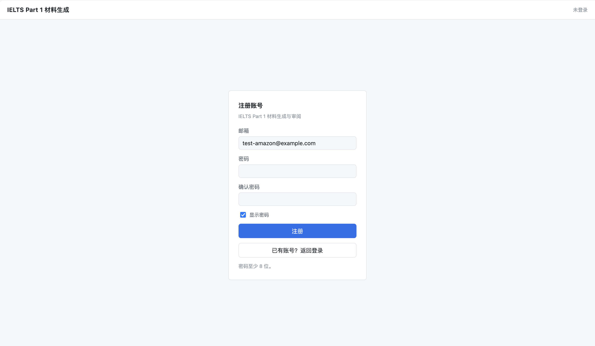

---

## 1. 生成一批材料

在“场景选择”页面：

1. 勾选需要的场景；
2. 设置每个场景生成几套，默认每个场景生成 2 套；
3. 也可以填写一个自定义场景；
4. 点击“提交生成”。

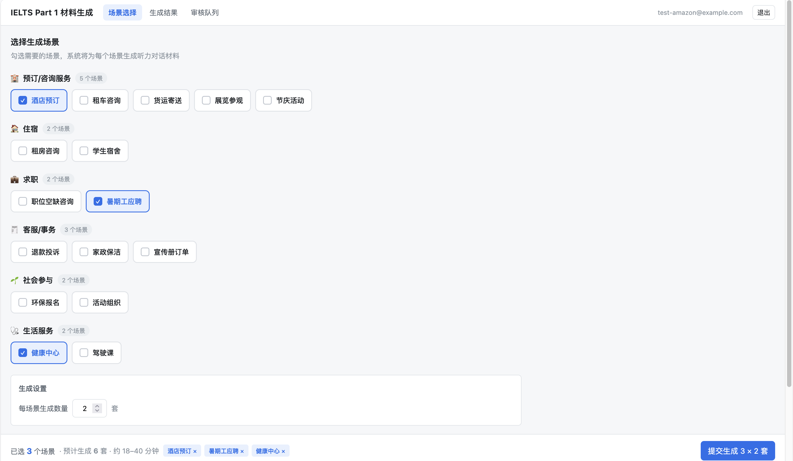

提交后会进入结果页。系统同时生成多套，其余任务自动排队。每套只有在听力材料和 10 道题都完成后，
才会计入“已完成”数量。

你可以离开或刷新页面，后台任务不会中断。重新打开“生成结果”即可继续查看进度。

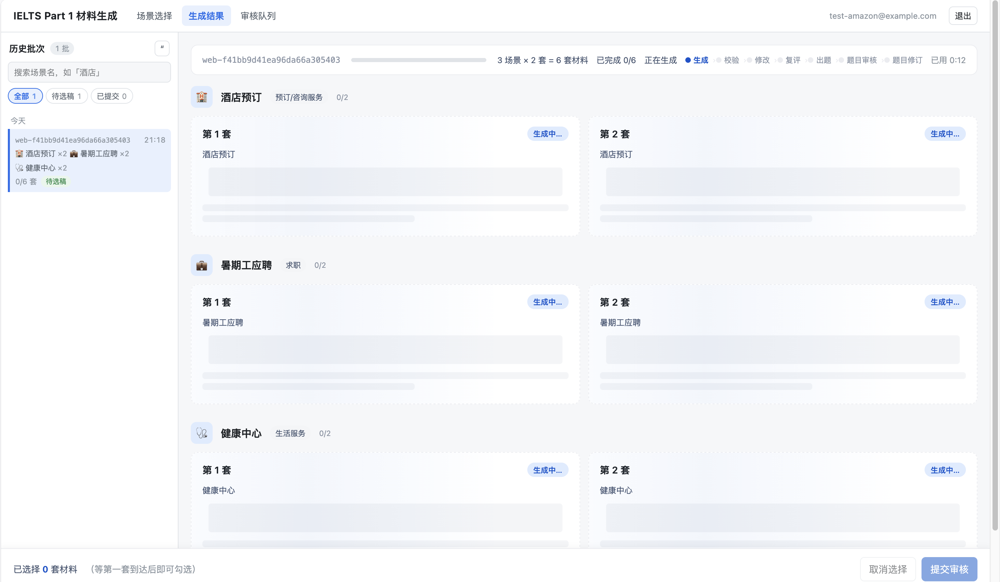

全部完成后，结果页会显示每个场景的完成数量和对应材料卡片。点击卡片上的“阅读全文”即可开始审阅。

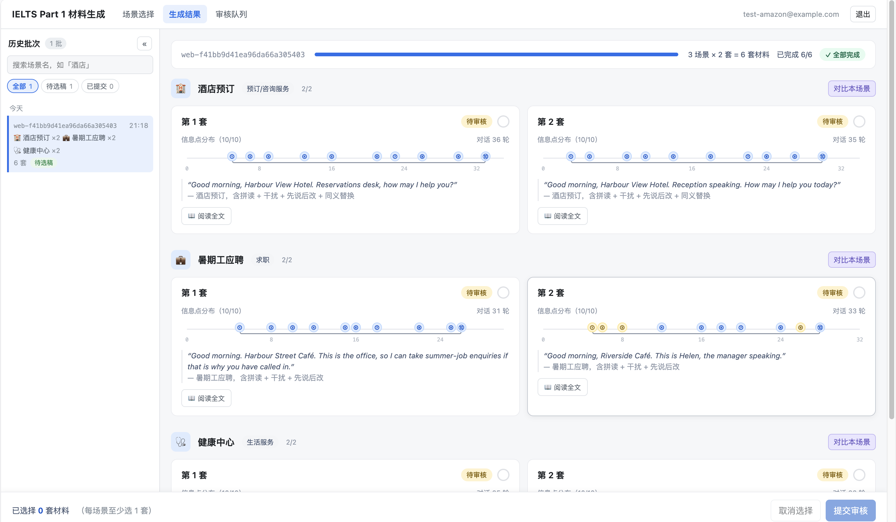

材料卡会预览两组题目的题号范围和题型。每套按 `4+6`、`5+5` 或 `6+4` 分组，题型为 Form、
Note 或 Table；两组可以使用相同题型。

### 某一套生成失败怎么办

已成功的套件可以照常使用。运行结束但尚未交付齐时，结果页会检查剩余位置：

- 题目生成或审核的模型调用失败时，点击“重试生成剩余 N 套”：从已保存的听力材料继续题目生成与审核；若后续质量检查要求换稿，未交付位置仍可能更换材料，其他已交付套件不受影响；
- 有可用断点时，点击“继续生成剩余 N 套”；
- 没有可用断点时，点击“补生成这 N 套”；
- 两种情况同时存在时，点击“继续断点并补生成剩余 N 套”。

打开历史批次也能使用这些入口；仅打开页面不会启动生成。点击后：

- 仍在当前批次和当前面板中生成；
- 不会重跑已经成功的套件；
- 成功后会从 `8/9` 自动变成 `9/9`；
- 失败提示会自动消失。

断点读取失败时，点击“重新检查断点”。如果提交后网络中断，点击“确认同一次恢复”，系统会确认原请求，避免重复启动。服务器已交付齐但页面尚未读全时，点击“刷新已交付材料”。

---

## 2. 查看一套材料

点击卡片上的“阅读全文”。页面包含两个页签。

### 对话原文

这里可以查看：

- 完整对话和信息点分布；
- 原文中的答案证据高亮；
- 每个信息点的类型和引用；
- 考点小结、可用题型和篇幅；
- 音频播放器。

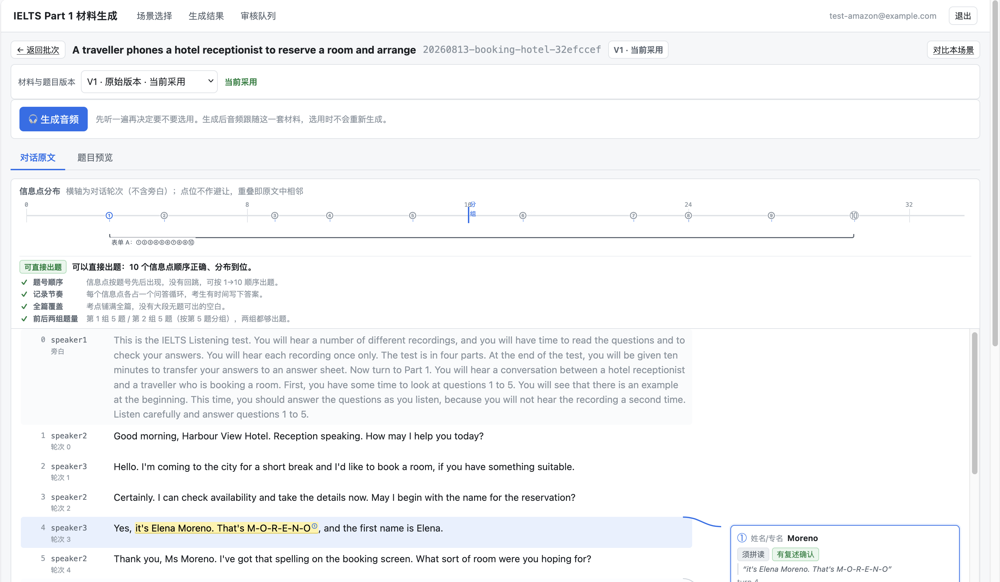

### 题目预览

这里按真实版式展示 Form、Note 或 Table。默认是考生视角；打开“显示答案和证据”后，可以检查答案、
原文证据和题解。

点击一道题即可选中 Q1-Q10，并在右侧提交评价。

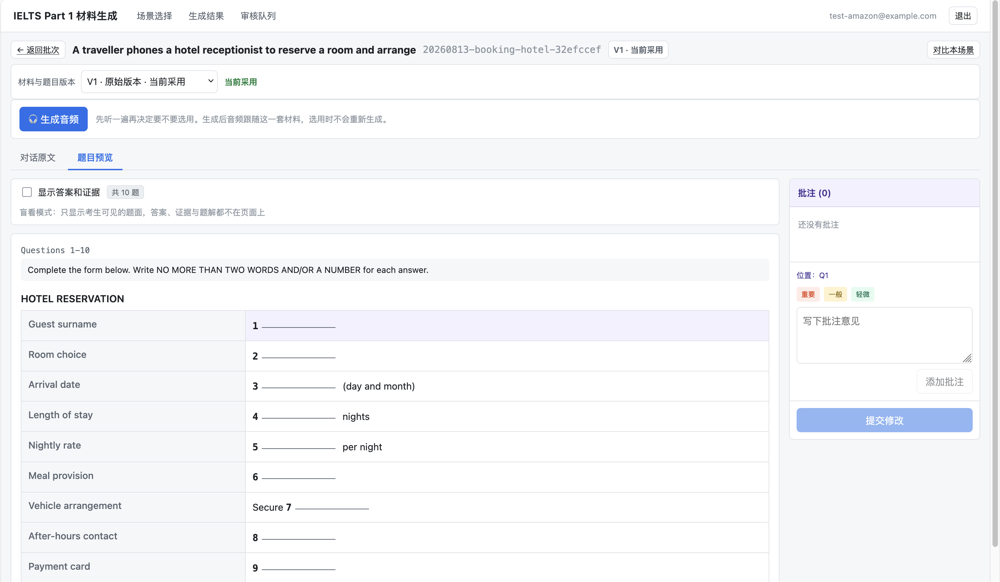

打开“显示答案和证据”后，答案、原文引证和题解会显示在对应题目下方。

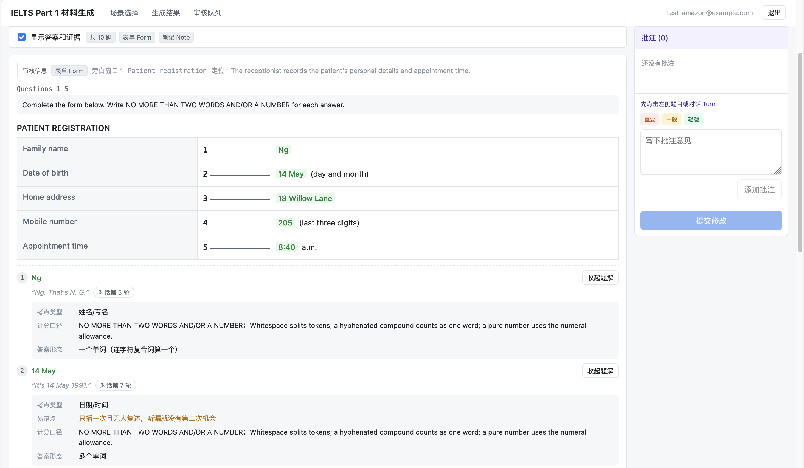

### 导出给下游系统（QTI 2.2）

点击「导出 QTI 2.2（Vn）」下载当前题目版本。需要导出其他版本时，先切换版本再点击导出。

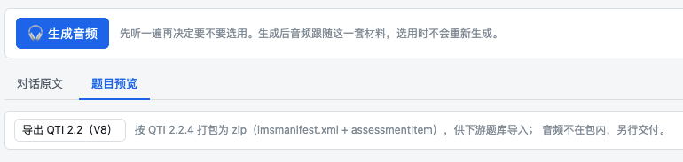

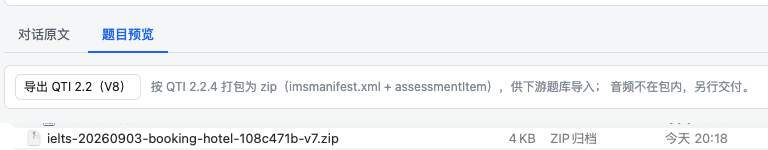

下载内容为 QTI 2.2.4 zip，不包含音频。导出以当前选择的版本为准，保留该版本题面、标准答案和可接受答案；不会因历史审核意见或旧版本差异拒绝导出。只有缺少必要字段、题号对应错误或无法转换的结构才会阻断。

---

## 3. 试听

在阅读页点击“生成音频”。首次生成需要等待一段时间，完成后可以：

- 播放全文；
- 调整倍速；
- 按 Turn 播放；
- 自动跟随当前原文。

试听不会自动选稿。音频属于当前材料版本，之后采用该版本时不需要重复生成。

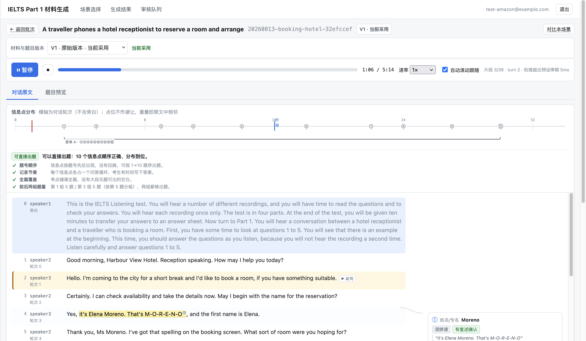

---

## 4. 评价并局部修改材料原文

可以对单个对话 Turn 提交以下修改：

- 删除冗余表达或复述；
- 缩短句子；
- 修正局部语法。

**一次只能处理一个非旁白 Turn，且不能修改题目或答案。**

### 提交 Turn 批注

1. 打开“对话原文”；
2. 点击需要修改的非旁白 Turn；
3. 在右侧选择“重要 / 一般 / 轻微”；
4. 填写修改意见；
5. 点击“添加批注”；
6. 点击“分析并局部修改”。

下图中，Turn 29 被选中修改：

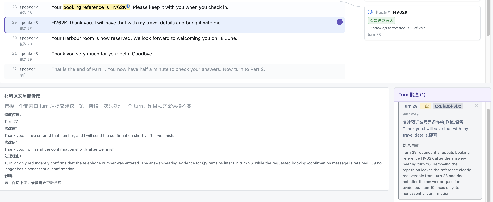

### 查看处理进度

开始处理后，页面会显示进度。可以刷新或离开页面，任务会在后台继续运行。

### 修改成功

修改成功后会生成新版本，并显示修改前后内容和处理理由。题目保持不变，录音需要重新生成。

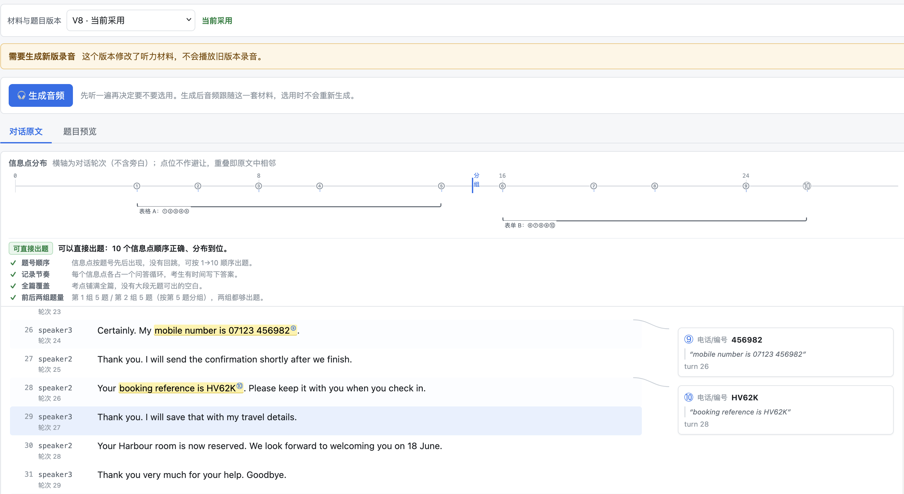

### 哪些修改会被拒绝

以下意见不会执行：

- 修改答案或答案证据；
- 修改题型、题组或信息点；
- 同时修改多个 Turn；
- 大范围重写材料。

系统会说明意见是“会影响题目或答案”还是“超出局部范围”，且不会生成新版本。

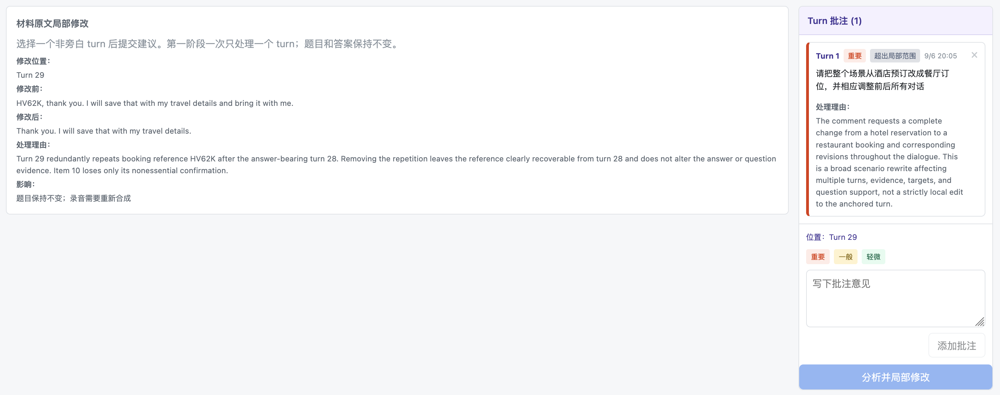

### 局部修改失败后怎么办

处理失败时，原版本不会改变。按页面提示调整意见后可以重新提交。

---

## 5. 评价并修改题目

在“题目预览”中：

1. 点击需要评价的题目，确认该题已被选中；
2. 选择“重要 / 一般 / 轻微”；
3. 输入修改意见；
4. 点击“添加”，完成评价提交。

系统会先判断意见应该如何处理，不会立即覆盖现有内容。

> **注意：** 必须先选中题目并选择重要程度，填写修改意见后再点击“添加”，评价才会提交成功。

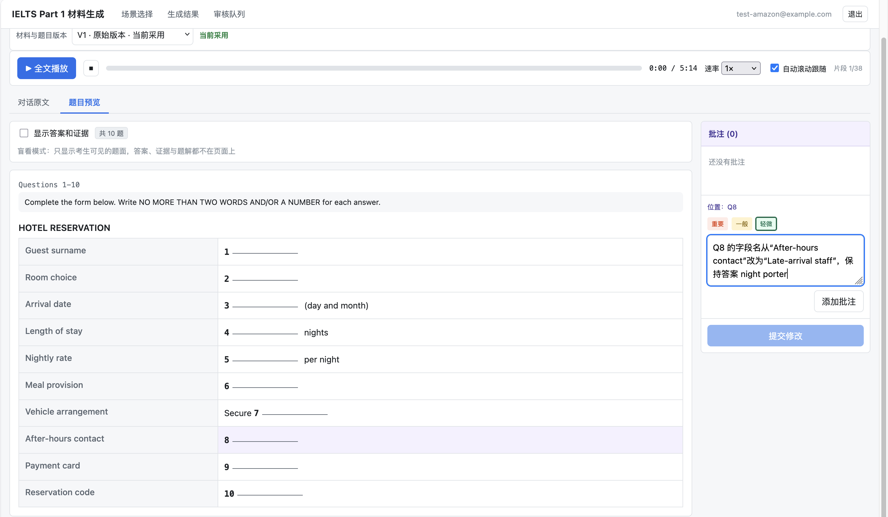

添加批注后，点击“提交修改”才会开始处理。页面随后会显示当前修改步骤；处理过程中无需重复提交。

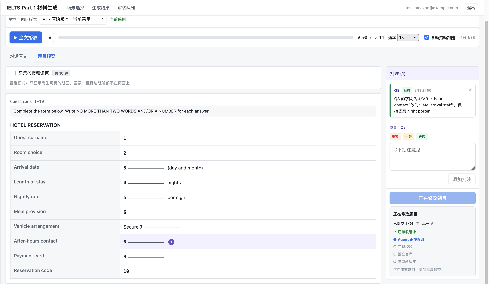

### 四种处理结果

| 页面结果 | 代表什么 | 你需要做什么 |
| --- | --- | --- |
| **无需修改** | 当前内容已经满足要求，或意见不成立 | 查看系统给出的理由和引证 |
| **修改题目** | 只需调整题面、答案或证据 | 等待新版本生成 |
| **需要重新命题** | 需要调整题型、题组、布局或信息点规划 | 点击“确认重新命题” |
| **需要修改材料** | 当前听力原文不支持目标答案或要求 | 点击“确认修改材料” |

处理结果会列出每条评价的判断、原因和下一步操作；需要修改材料或重新命题时，请先核对范围再确认。

### 修改题目

局部修改只处理评价所指向的题目，并保持其他题和听力原文不变。修改通过质量检查后才会生成新版本。

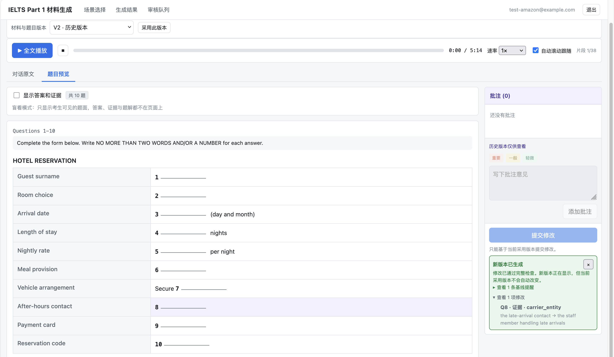

### 重新命题

适合以下需求：

- 将一组题从 Form 改成 Note；
- 重新组织字段；
- 调整题组边界；
- 更换或重新规划答案信息点。

如果只要求调整布局，系统会尽量保留原听力材料和原有答案信息点。确认后会重建完整 10 道题。

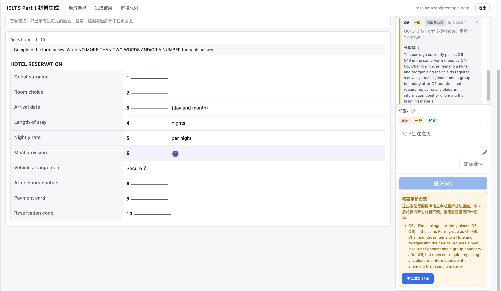

重新命题完成后，页面会显示新题目版本和具体修改内容。

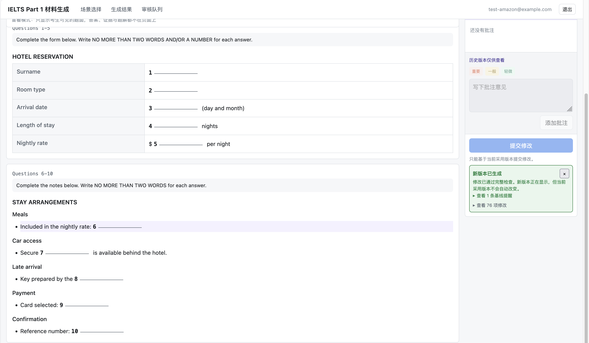

### 修改材料

当目标答案在原文中不存在时，不能只改题目。例如把 `three nights` 改为 `four nights`，必须同步修改
听力对话中的相关事实、复述和对应题目的答案与证据。

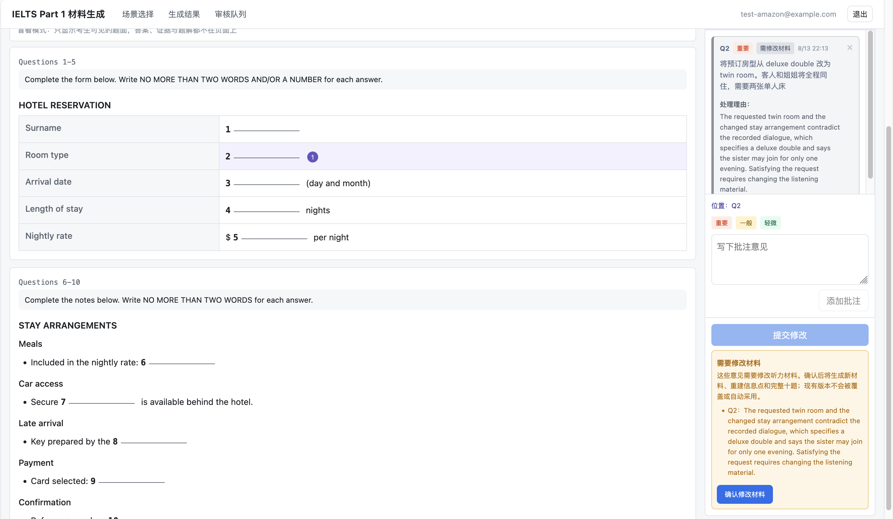

材料修改以当前采用版本为基础，只改评价涉及的原文及相关题目答案、证据，并核对关联影响；无关原文和题面保持不变。原版本已有的其他审核意见不会阻断本次修改。若需要扩大修改范围，系统会说明原因，不会自动整篇重写。

材料修改完成后，新版本会提示重新生成音频，避免继续播放旧版本录音。

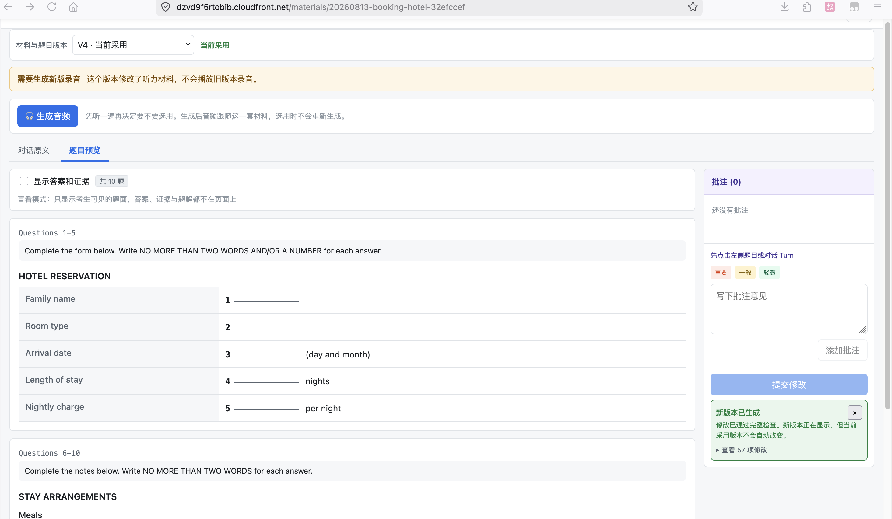

### 修改过程中可以离开页面吗

可以。题目修改、重新命题和材料修改都在后台继续运行。刷新或离开页面不会中断任务，回来后会恢复
当前进度。

耗时取决于模型响应和需要执行的检查。请以页面的进度、完成或失败状态为准；网络断开时重新进入查看，
不要仅凭“没有错误提示”判断任务仍在运行，也不要重复提交。

如果任务失败，点击页面上的“重新尝试命题”或“重新尝试修改材料”。系统会沿用原意见启动新的执行，
不需要删除后重新写批注。

如果意见需要大幅修改听力材料，自动修改不一定能够通过完整质量检查。遇到这种情况，建议返回场景
选择页重新生成一套材料，不要连续重复尝试修改。

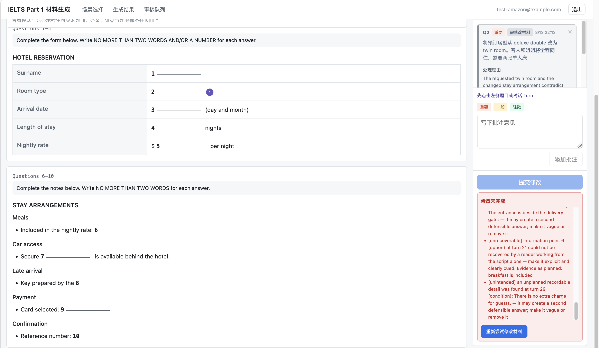

---

## 6. 查看和采用版本

修改成功后会生成 V2、V3 等新版本，但**不会自动采用**。

在“材料与题目版本”中切换版本进行检查。切换时以下内容会一起变化：

- 听力材料；
- 蓝图和题目；
- 答案与证据；
- 对应音频。

确认新版本合适后，再点击“采用”。之后的新修改会基于当前采用版本继续生成。

> **注意：** 如果要在新版本上继续评价，必须先点击“采用”。仅切换到新版本查看，不会改变后续评价
> 所基于的版本。

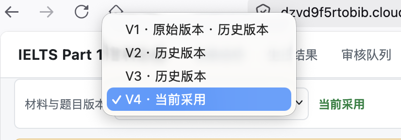

---

## 7. 对比、选稿和提交

### 对比同场景材料

同一场景有 2 套以上时，点击“对比本场景”，再选择 A、B 两套。页面会并排显示信息点、题型、篇幅和
考点差异。对比页只帮助判断，不会自动选稿。

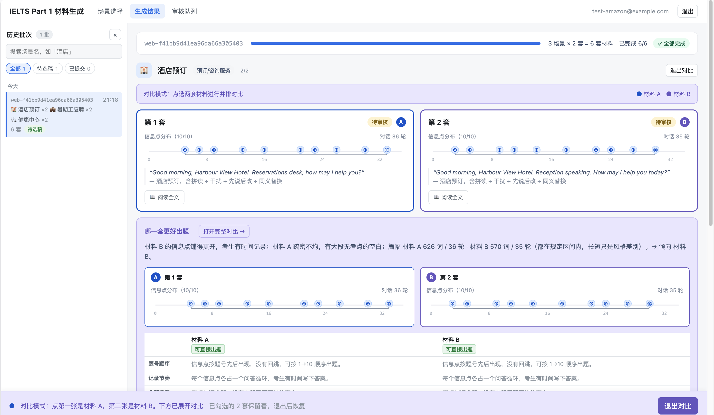

### 选稿

回到结果页，勾选需要保留的材料。每个已有结果的场景至少选择 1 套，之后点击“提交审核”。

提交前核对勾选的材料；只有明确选中的材料会进入本次提交。

### 审核队列

点击“提交审核”后，所选材料会进入顶部导航中的“审核队列”。审核队列按提交批次分组显示材料；如需
继续调整选择，可以撤回整批，返回生成结果页重新选稿。

需要撤回时，在审核队列中找到对应材料并使用“撤回”操作。

### 查看历史

结果页左侧可以打开历史批次，按场景或状态查找：

- **待选稿**：可以继续选择和提交；
- **已提交**：只读，可以查看和试听；

从历史批次中打开原批次，可继续查看已交付材料及未完成套件的状态。

---

## 8. 常见问题

### 页面刷新后任务不见了吗

刷新页面不会取消服务器已经接受的生成或修改。重新进入原批次或原材料查看进度；服务器更新、运行时间用尽或调用故障导致中断时，按页面提示继续或重试。

### 为什么生成了新版本，页面内容却没有自动变

新版本不会自动采用。请在版本选择器中检查并手动采用。

### 为什么系统要求修改材料

说明目标答案或要求在当前听力原文中没有依据。只改题目会产生无法从录音中听到的答案。

### 为什么修改没有通过

修改结果须通过对应路径的质量检查：材料事实修改检查修改范围及关联影响，重新命题检查新题包。页面会显示主要失败原因；可以按提示调整意见，或点击重新尝试。

### 为什么删除复述后“有复述或确认”标签消失了

这是正常现象。该标签来自当前版本蓝图中的 `confirmed` 状态。删除非必要复述后，系统会将对应信息点
标记为未确认，但答案、证据和题目仍保持不变。

---

## 9. 名词说明

| 名称 | 含义 |
| --- | --- |
| 批次 | 一次提交生成的全部材料 |
| 套件 | 一段听力对话及对应的 10 道题 |
| 信息点 | 录音中可作为答案的具体细节 |
| 批注 / 评价 | 针对某一道题提交的修改意见 |
| 版本 | 一套相互对应的材料、蓝图、题目、答案和证据 |
| 当前采用 | 正式显示并作为下一次修改基础的版本 |
| 旁注 | 对话原文右侧解释信息点的小卡片，不是用户评价 |
| Turn 批注 | 针对某一句对话原文提交的局部修改意见 |
| QTI 包 | 按 IMS QTI 2.2.4 标准打包的一版题目（zip），供下游题库或考试系统导入 |

## 10. 提示词管理（管理员）

工作区分为四个页签：

| 页签 | 用途 |
|---|---|
| 提示词编辑 | 选择模块、编辑业务指令、对照当前生效文本并保存草稿 |
| 样例试运行 | 用同一样例比较生效版本与已保存草稿的输出 |
| 完整场景对比 | 对同一场景生成两套材料和题目，查看进度与完整结果 |
| 版本管理 | 查看发布历史与修改差异、回滚或恢复内置默认提示词 |

多人管理使用同一份共享草稿，页面显示最近保存人和保存时间。保存或刷新时，不同提示词模块的修改会自动合并；同一模块有不同修改时，会显示“我的编辑”和“服务器最新草稿”，逐项选择“保留我的编辑”或“采用服务器内容”后再保存。刷新、切换页面或重新进入不会跳过冲突确认。若选择后其他管理员又修改了同一模块，保存时仍会再次检查。保存不会自动发布。

未保存的提示词编辑会按账号暂存在当前浏览器标签页，切换到用户管理再返回时可恢复；这不等同于保存服务器草稿。若服务器草稿已变化，会合并不同模块的修改，同一模块的不同修改仍需你确认。

样例试运行提交后若网络中断，请使用“重试确认同一测试”，系统会找回原任务，不会另起一次测试。

编辑区的“保存并前往测试”会先保存整套草稿，再打开当前模块的样例试运行。它不会自动调用模型；填写样例并点击“运行对比”后才开始测试。

样例试运行和完整场景对比各自提供“历史”按钮，在右侧打开记录列表。点击记录后，主区域显示当时的输入、版本和结果；“返回当前测试／返回当前对比”可回到本次工作。查看历史不会清空当前输入，也不会取消后台生成。“复用输入”仅复制样例，下次运行使用当前生效版本和当前已保存草稿。

顶部显示当前生效版本，以及草稿与生效版本的差异项数；有差异不代表上一次发布未成功。点击“发布整套草稿”后，先核对所有修改项，再点击“确认发布”。发布仅影响新任务。保存草稿和发布是两步操作。

右上角“规则参考”提供只读 Skill 资料；当前不支持在线编辑 Skill。关闭侧栏后可继续原来的编辑。

版本记录以绿色“当前生效”标识正在使用的版本。修改项以标签展示，点击“查看修改”展开对照；较长的未修改内容默认折叠，可点击“显示全部上下文”展开。复制按钮始终复制完整文本。发布、回滚和恢复默认都需在居中弹窗中确认，取消不会执行操作。回滚保留共享草稿，可能产生草稿差异。“恢复内置默认提示词”位于发布历史底部，确认后发布默认版本并同步重置共享草稿，旧草稿内容会被替换，发布历史保留。若期间其他管理员更新草稿，系统保留对方内容并说明默认版已生效、草稿未同步。管理页面的时间以浏览器本地时区、中文 24 小时格式显示。
