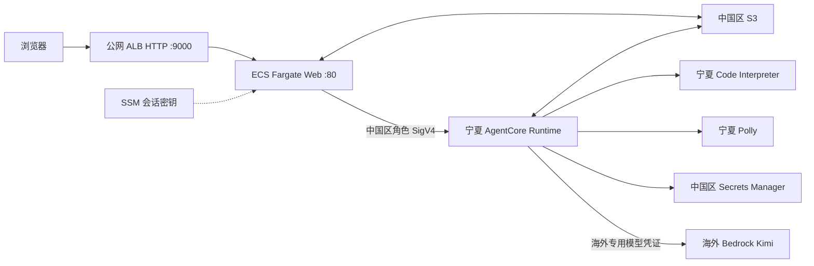

# AWS Global 与中国区（宁夏）架构及服务对比

本页比较本项目原 Global 实现与当前中国区交付实现。Global 列是历史架构基线，
不是现行中国区部署入口；本表也不是 AWS 全部产品的区域可用性清单。

## 1. 服务与实现对比

| 能力 | 原 Global 实现（历史基线） | 当前中国区交付实现 | 交付说明 |
|---|---|---|---|
| 账号与区域 | aws分区，默认us-east-1 | 独立aws-cn账号，完整发布限定cn-northwest-1 | 应用区域与海外模型区域分开配置 |
| 浏览器入口 | CloudFront HTTPS → ALB → Web | 公网ALB HTTP :9000 → Web :80 | 当前不部署CloudFront；如需HTTPS/自有域名须单独设计实施 |
| Web服务 | ECS Fargate / FastAPI | 宁夏ECS Fargate / FastAPI，ARM64 | 自建登录、API、SSE与后台任务职责保留 |
| Agent执行 | AgentCore Runtime | 宁夏AgentCore Runtime | 同一套材料/题目编排与隔离逻辑 |
| 审核计算沙箱 | AgentCore Code Interpreter | 宁夏Code Interpreter | 输入隔离与指标脚本继续使用 |
| 大模型 | Bedrock Mantle GPT-5.6 | 海外Bedrock Kimi K2.5/Kimi K3 | 中国区应用仍向海外模型服务发送推理请求 |
| 模型API | Mantle Responses | K2.5：Mantle Chat Completions；K3：Bedrock Runtime Chat Completions | 按模型使用不同端点、参数和权限 |
| 模型凭证 | Bedrock bearer或Mantle签发路径 | 中国区Secrets Manager引用海外专用Bedrock凭证 | 生产不依赖开发机Midway/profile，按有效期轮换 |
| 语音 | Polly british-neural预设（Brian/Amy/Arthur） | Polly china-standard预设（Emma/Amy/Brian） | 按需合成；浏览器走Web鉴权音频代理 |
| 数据与检查点 | S3 | 中国区S3，私有、版本化、SSE-S3 | 材料、题目、断点、批注、提示词配置等；历史数据迁移未包含在当前工具 |
| 用户与会话 | 自建账号、S3用户数据、SSM会话密钥 | 相同组件，中国区资源 | 管理员、密码重置和提示词权限按应用实现 |
| 日志 | CloudWatch | 中国区CloudWatch | Web与Runtime日志分开定位，模型调用故障需结合断点 |
| 发布工具 | 历史shell与Global配置 | Python/boto3 prepare/edge/web、Runtime release、镜像推送 | 唯一发布标签、digest固定、READY/健康检查和回退记录 |

## 2. 当前中国区数据流

Web 负责登录、管理员权限、共享提示词、批次恢复、版本管理、QTI 导出和 SSE 进度。
Runtime 负责材料生成、可行性检查、题目生成、盲审、修订与按需音频。
已交付材料的事实修改以老师采用的版本为基础，只修改相关原文、答案和证据并检查关联影响。

浏览器离开页面不会取消已接受的后台任务。Web 服务更新或进程中断可能终止当前执行，
用户须根据持久化状态继续或重试；已交付套件保留。运行中的任务及原批次恢复固定使用提交时的模型和提示词版本。

## 3. 模型与认证

应用资源部署在 `cn-northwest-1`，模型区域独立配置，默认 `us-east-1`。
K2.5 使用 Mantle Chat Completions，K3 使用 Bedrock Runtime Chat Completions。
中国区 Runtime 角色负责读取指定 Secret；海外专用模型身份负责推理权限，两者不能互相替代。
生产模型凭证有独立有效期，开发机登录或 VPN 切换不会刷新该凭证。

Secret 只以 ARN 引用进入部署配置；模型实例创建时读取当前凭证，已有实例不会自动替换内存中的凭证。
完整配置、K3 权限与轮换见 [模型凭证说明](CHINA_MODEL_CREDENTIALS.md)。

## 4. 网络与数据配置

- 当前工具使用默认 VPC，要求至少两个可用区具有有效公网 IGW 路由的子网；ALB 监听 HTTP 9000，Web 仅接受 ALB 安全组访问。
- Runtime 使用 PUBLIC 网络模式，调用 AWS 公网端点；当前没有部署固定 NAT 出口或域名白名单。
- 当前入口没有 HTTPS 传输加密。自有域名、证书、入口限制和其他客户网络要求须单独落实配置。
- 中国区应用向海外模型服务发送推理内容；不能描述为“所有处理均在境内”或“无跨境调用”。
- S3 私有、开启版本控制，当前工具要求 SSE-S3；已有 SSE-KMS 桶不能直接由该工具接管。
- 音频由 Runtime 按需合成，浏览器通过登录保护的 `/api/material-audio` 读取，支持单段 Range；不直接使用 S3 预签名地址播放。
- Web 当前为单任务部署；用户存储具有条件写保护，但后台执行仍需另行设计多副本协调才能实现高可用。

## 5. 部署与交接

本项目现行交付物是 Python/boto3 发布工具，不包含 CDK 或 Terraform 模板。
按 [中国区部署指南](CHINA_DEPLOYMENT.md) 完成首次部署、分层更新、健康检查和旧镜像回退；
使用 [发布台账](../deploy/RELEASES.md) 记录实际环境版本与回退依据。
用户操作见 [使用指南](../USER_GUIDE.md)，提示词配置见 [提示词管理说明](prompt-management.md)。
